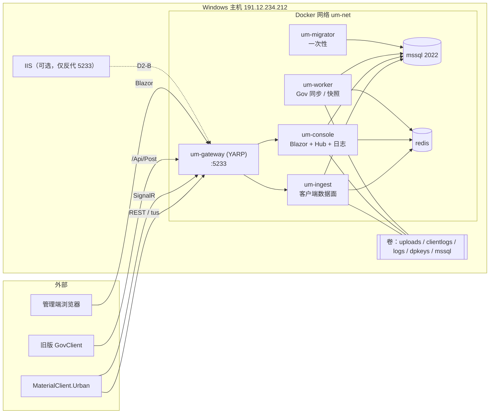

# 03 目标架构与服务拆分

## 1. 设计原则

1. **一个入口，多个角色。** 外部只看到 `191.12.234.212:5233`；内部按路径把流量分给不同角色容器。
2. **同一份代码、同一个镜像。** 角色由配置决定（启用哪些端点、哪些 Worker），不复制代码、不重命名 AppService，从而 ABP 自动路由与 JSON 行为天然一致。
3. **共享一个数据库。** 称重记录、附件、项目授权在同一个 `UrbanManagementDbContext` 里，且有跨表业务（receive 时关联 attachmentIds）。拆库会引入分布式事务，收益远小于风险，本蓝图**不拆库**。
4. **有状态的东西要么单实例，要么先外置再扩容。** 见 [`01`](01-现状考古.md) §4。

## 2. 最终拓扑（Phase 2，推荐稳定形态）



## 3. 容器与角色划分

| 容器 | 角色 | 承载内容 | 副本 | 对外暴露 |
|------|------|----------|------|----------|
| `um-gateway` | — | YARP 反向代理、路由表、转发头 | 1 | 5233（D2-A）或 127.0.0.1:15233（D2-B） |
| `um-ingest` | `Ingest` | R1–R11：上报、附件（Base64/multipart/tus）、激活、Legacy | 1（Phase 3 后可多副本） | 否 |
| `um-console` | `Console` | Blazor 管理端、管理类 `/api/app/*`、`/hubs/devicestatus`、日志拉取、`/api/client-log/*`、`/ClientLogs/*` | 1（Hub 与 Blazor 电路有状态） | 否 |
| `um-worker` | `Worker` | `GovSyncBackgroundWorker`、`ClientStatusSnapshotBackgroundWorker` | **严格 1** | 否（仅健康检查） |
| `um-migrator` | `Migrator` | `Database.MigrateAsync()`；首次切换时执行 SQLite→MSSQL 数据导入 | 运行即退出 | 否 |
| `mssql` | — | `mcr.microsoft.com/mssql/server:2022-latest` | 1 | 否（运维需要时仅绑 127.0.0.1:14333） |
| `redis` | — | ABP 分布式缓存 + SignalR backplane | 1 | 否 |

为什么 Hub 跟 Blazor 管理端放在一起（Phase 2）：`ClientLogs.razor` 直接注入 `IClientLogAppService`，而该服务用进程内 `TaskCompletionSource` 等待 Hub 收到的客户端回包。两者分开就要先把日志拉取改成内部 API（Phase 3 再做）。

## 4. 角色开关（服务端改动，客户端无感）

新增配置节（示意）：

```json
{
  "Hosting": {
    "Roles": [],
    "AutoMigrate": true
  }
}
```

`Roles` 为空表示"全部角色"。不要在 `appsettings.json` 里写满默认数组：.NET 配置绑定数组是**按下标合并**的，环境变量 `Hosting__Roles__0=Console` 只会覆盖第 0 项，其余默认项会残留。

| 开关 | 作用点 | 说明 |
|------|--------|------|
| 含 `Console` | `MapHub<DeviceStatusHub>`、`MapBlazorHub`、`MapFallbackToPage`、`/ClientLogs` 静态文件 | 其他角色不映射，避免误入 |
| 含 `Ingest` | `MapTus(...)` | tus 只在 ingest |
| 含 `Migrator` 或 `AutoMigrate=true` | `Database.MigrateAsync()` | 防止多个容器同时启动时并发迁移 |
| `Worker` | 复用现有 `BackgroundServices:Polling`、`BasePlatformSync:Enabled`、`ClientStatusSnapshot:Enabled` | 非 worker 容器全部设 false，**无需改代码** |
| 默认值 | `Roles` 为空（= 全部）、`AutoMigrate = true` | 保证 Phase 1 单容器与本地开发行为与现在一致 |

Controller 与 ABP 自动 API 在每个角色里都会注册（同一程序集），**由网关决定谁能被访问**。可选加一层防御：非本角色负责的路径返回 404 的轻量中间件（内部网络本就不可达，属锦上添花）。

实现约束（来自本仓 traits）：角色开关用 `IOptions<HostingOptions>` 读取；不新增注册为 DI 的 Helper；不引入 tuple。

## 5. 网关路由表（YARP，按顺序匹配，路径大小写不敏感）

| 顺序 | 匹配 | 目标 | 备注 |
|------|------|------|------|
| 1 | `/hubs/devicestatus/{**}` | console | WebSocket；含 `/negotiate` |
| 2 | `/_blazor/{**}` | console | Blazor 电路 |
| 3 | `/api/urban/auth/{**}` | ingest | R1 |
| 4 | `/Api/Post` | ingest | R11 |
| 5 | `/api/urban-attachment/{**}` | ingest | R8–R10（tus 同实例） |
| 6 | `/api/app/urban-attachment/upload` | ingest | R7 |
| 7 | `/api/app/urban-weighing-record/receive` | ingest | R2 |
| 8 | `/api/app/urban-weighing-record/pending-server-approval-sync` | ingest | R3 |
| 9 | `/api/app/urban-weighing-record/ack-approval-sync` | ingest | R4 |
| 10 | `/api/app/urban-checkpoint-passage/receive` | ingest | R5 |
| 11 | `/api/app/urban-finished-product-passage/receive` | ingest | R6 |
| 12 | `/api/client-log/{**}`、`/ClientLogs/{**}` | console | 日志下载 |
| 13 | `/api/{**}` | console | 其余管理类 ABP API |
| 14 | `/{**}` | console | 页面、静态资源、兜底 |

网关配置要点：

- `Transforms`：保留原始 `Host`（`RequestHeaderOriginalHost: true`），追加 `X-Forwarded-For/Proto/Host`。
- `HttpRequest.ActivityTimeout` ≥ 5 分钟（客户端上传超时 240 s）。
- Kestrel `MaxRequestBodySize` 设为 `null` 或 ≥ 16 MB，由后端应用自行限制。
- 健康检查：主动探测各后端 `/health/ready`。

## 6. 应用侧容器化改动清单（全部在 UrbanManagement 仓）

| 改动 | 目的 |
|------|------|
| `UseForwardedHeaders`（KnownNetworks = Docker 网段） | tus `Location`、客户端 IP 日志、流量计量正确 |
| `AddDataProtection().PersistKeysToFileSystem("/app/keys")`（或 Redis） | 容器重建后 Blazor / 防伪令牌不失效；多角色共用同一密钥环 |
| `AddSignalR().AddStackExchangeRedis(...)`（Phase 2 起） | worker / ingest 侧 `IHubContext` 推送可达 console 上的连接 |
| 健康检查 `/health/live`、`/health/ready`（DB + Redis） | compose `healthcheck`、网关探测；需在 `MapFallbackToPage` 之前映射 |
| Serilog 同时输出 Console | `docker logs` 可见；文件日志保留在卷上 |
| `Dockerfile`：`mcr.microsoft.com/dotnet/aspnet:10.0`（Debian，含 tzdata/ICU），非 root 用户，`TZ=Asia/Shanghai` | 时区、中文排序/文化 |
| 发布改为 `linux-x64` 框架依赖；`web.config` 不再需要 | 去 IIS |
| 附件路径分隔符规范化（见 [`04`](04-数据库迁移SQLite到MSSQL.md) §5） | Linux 下读取历史附件 |

## 7. compose 草图（Phase 2）

```yaml
name: urbanmanagement

x-um-app: &um-app
  image: urbanmanagement-app:${UM_TAG}
  restart: unless-stopped
  environment: &um-env
    TZ: Asia/Shanghai
    ASPNETCORE_ENVIRONMENT: Production
    ConnectionStrings__Default: "Server=mssql,1433;Database=UrbanManagement;User Id=um_app;Password=${UM_DB_PASSWORD};TrustServerCertificate=True"
    Redis__Configuration: "redis:6379"
    Hosting__AutoMigrate: "false"
    BackgroundServices__Polling: "false"
    BasePlatformSync__Enabled: "false"
    ClientStatusSnapshot__Enabled: "false"
  volumes:
    - ./secrets/appsettings.secret.json:/app/appsettings.secret.json:ro
    - um-uploads:/app/Uploads
    - um-clientlogs:/app/ClientLogs
    - um-logs:/app/Logs
    - um-dpkeys:/app/keys
  depends_on:
    mssql: { condition: service_healthy }
    redis: { condition: service_started }
    um-migrator: { condition: service_completed_successfully }
  networks: [um-net]

services:
  um-gateway:
    image: urbanmanagement-gateway:${UM_TAG}
    restart: unless-stopped
    environment: { TZ: Asia/Shanghai }
    ports: ["${UM_PUBLIC_BIND:-0.0.0.0:5233}:8080"]
    depends_on: [um-ingest, um-console]
    networks: [um-net]

  um-ingest:
    <<: *um-app
    environment:
      <<: *um-env
      Hosting__Roles__0: Ingest

  um-console:
    <<: *um-app
    environment:
      <<: *um-env
      Hosting__Roles__0: Console

  um-worker:
    <<: *um-app
    environment:
      <<: *um-env
      Hosting__Roles__0: Worker
      BackgroundServices__Polling: "true"        # 按现网实际值
      BasePlatformSync__Enabled: "true"
      ClientStatusSnapshot__Enabled: "true"

  um-migrator:
    image: urbanmanagement-app:${UM_TAG}
    restart: "no"
    environment:
      <<: *um-env
      Hosting__Roles__0: Migrator
      Hosting__AutoMigrate: "true"
    depends_on: { mssql: { condition: service_healthy } }
    networks: [um-net]

  mssql:
    image: mcr.microsoft.com/mssql/server:2022-latest
    restart: unless-stopped
    environment:
      ACCEPT_EULA: "Y"
      MSSQL_PID: "${UM_MSSQL_PID}"          # Express / Standard，见 D3
      MSSQL_SA_PASSWORD: "${UM_SA_PASSWORD}"
      MSSQL_COLLATION: Chinese_PRC_CI_AS
      TZ: Asia/Shanghai
    volumes: [um-mssql:/var/opt/mssql]
    healthcheck:
      test: ["CMD-SHELL", "/opt/mssql-tools18/bin/sqlcmd -C -S localhost -U sa -P \"$$MSSQL_SA_PASSWORD\" -Q 'SELECT 1' || exit 1"]
      interval: 10s
      retries: 12
    networks: [um-net]

  redis:
    image: redis:7-alpine
    restart: unless-stopped
    command: ["redis-server", "--appendonly", "yes"]
    volumes: [um-redis:/data]
    networks: [um-net]

volumes: { um-uploads: {}, um-clientlogs: {}, um-logs: {}, um-dpkeys: {}, um-mssql: {}, um-redis: {} }
networks: { um-net: {} }
```

> 草图中的密钥全部来自 `.env` / `secrets/`，不进仓库。`um_app` 是最小权限业务账号（`db_datareader`/`db_datawriter`/`db_ddladmin` 仅给 migrator），不要让应用用 `sa`。

Phase 1 形态：只有 `um-gateway` + 一个 `um-app`（不设 `Hosting__Roles`，即全部角色、`AutoMigrate=true`、Worker 开关按现网）+ `mssql` + `redis`。

## 8. Phase 3（可选深度拆分）

| 拆分 | 前置改造 | 收益 |
|------|----------|------|
| `um-realtime`（Hub + 日志拉取 + `/api/client-log` + `/ClientLogs`）与 `um-admin`（Blazor + 管理 API）分离 | realtime 暴露仅内网可达的 `/internal/client-log/*`；admin 侧 `IClientLogAppService` 改为调用该内部 API 的实现；Hub 推送走 backplane | 管理端发版不再断开工控机的 SignalR 连接 |
| `um-attachment` 从 ingest 拆出 | 无（路由 5、6 改指向） | 大文件 IO 不拖慢上报接口 |
| ingest / attachment 多副本 | `TusAttachmentResultStore` 改存 Redis（TTL 与 tus 过期一致 60 min）；`Uploads` 共享卷 | 横向扩展 |
| Hub 多副本 | `DeviceStatusHub` 的 4 个静态字典外置到 Redis；网关对 Hub 开会话粘性 | 实时面高可用 |

## 9. 明确不做

- 不拆数据库、不引入消息队列/事件总线来替代现有同步调用。
- 不引入 API 版本前缀（`/v2/...`）或改造路由风格。
- 不把 Blazor Server 改成 WASM / 前后端分离（属于另一项目）。
- 不在本升级中处理与容器化无关的技术债（如 `LegacyApiController` 中的临时诊断日志）。
