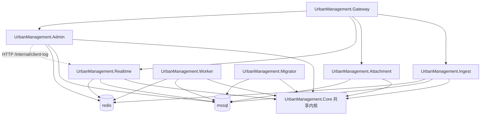

# 07 微服务工程拆分（后续蓝图）

> 状态：`IMPLEMENTED`（验收环境 5333）· 知识状态：`VERIFIED`（2026-11-03 评审可行并落地，见 §10；OpenSpec `refactor-urban-microservice-hosts`，待 Human `APPROVED` 与 squash 合入）  
> **不是**本升级切换日的阻塞项。§1–§9 是评审前的方案原文，表中「Phase 2 / Phase 3（已落地）」一列描述的是拆分前的状态。

## 1. 与现状的区分（必读）

| | Phase 2 / Phase 3（**已落地**） | 本文件描述的目标 |
|--|--------------------------------|------------------|
| 目标 | 进程职责分离、可独立重启 / 扩 ingest | **工程边界**分离：多 csproj、多 publish、多镜像 |
| 代码 | `UrbanManagement.App` + `Core` 一套 | 每服务一个可独立构建的宿主工程 |
| 镜像 | `urbanmanagement-app` 一个 app 镜像 + gateway | 每服务一镜像（或至少每服务独立 layer / tag） |
| 运行时开关 | `Hosting:Roles` 决定 Map 哪些端点 | 进程内**只有本服务该有的端点**；不再靠「代码都在、启动时不 Map」 |
| 对外契约 | 不变（C1–C3） | 仍须不变；靠网关路径表，不靠客户端改版 |
| 数据库 | 共享一个 `UrbanManagement` 库 | **默认仍共享一库**（与 [`03`](03-目标架构与服务拆分.md) §1.3 一致）；不把「拆库」绑进第一刀 |

一句话：**角色拆分解决部署拓扑；工程拆分解决构建与代码所有权。** 前者不替代后者。

当前仓库里已相对独立的工程：

- `UrbanManagement.Gateway`（YARP）— 已是单独工程与 compose 服务  
- `tools/UrbanManagement.DataImport` — 工具，不是运行时微服务  

其余角色（ingest / attachment / realtime / admin / worker / migrator）仍编译进同一 `UrbanManagement.App`。

## 2. 为什么要再做工程拆分

用户期望（2026-11-03）：按职责拆成微服务工程，而不是仅靠 `Hosting:Roles`。

在角色拆分已完成后，工程拆分的额外收益：

1. **发版面更小**：改 Admin Blazor 不必重编 / 重发含 Hub、tus、上报逻辑的巨型镜像（构建与扫描时间、误发风险）。
2. **依赖面更清晰**：Realtime 不必引用 Blazor 包；Admin 不必带 tusdotnet；Worker 不必带 UI。
3. **团队 / 审查边界**：PR 可按服务目录划分；与「谁拥有哪条客户端路径」对齐。

代价（必须接受）：

- 同仓内多 Dockerfile / CI 矩阵、本地调试变复杂  
- 若共享 EF 模型不当，会出现「同一实体两套迁移」或循环引用  
- 短期与现网切换无直接关系；**不要**和切 5233 绑在同一窗口

**硬约束（用户，2026-11-03）：微服务全部归属 `repos/UrbanManagement` 同仓；不拆成多个 Git 仓库。**

## 3. 建议的服务边界（第一目标拓扑）

对外仍只暴露网关；内部服务名可与现 compose 对齐，降低迁移成本。

| 工程（建议名） | 对应现容器 | 宿主内容 | 不得包含 |
|----------------|------------|----------|----------|
| `UrbanManagement.Gateway` | `um-gateway` | YARP 路由表、`/internal/**` 拒绝 | 业务 DbContext |
| `UrbanManagement.Ingest` | `um-ingest`（×N） | 上报、auth、Legacy、`/Api/Post`；**不含** tus | Blazor、Hub 静态状态 |
| `UrbanManagement.Attachment` | `um-attachment` | tus、multipart / upload API、tus 结果映射 | Hub、Blazor、Gov Worker |
| `UrbanManagement.Realtime` | `um-realtime` | `DeviceStatusHub`、`ClientLogAppService`、`/api/client-log`、`/ClientLogs`、`/internal/client-log` | Blazor 电路、tus |
| `UrbanManagement.Admin` | `um-admin` | Blazor Server、管理类 `/api/app/*`；client-log 走 HTTP 客户端（已有 `RemoteClientLogAppService` 形态） | Hub Map、tus |
| `UrbanManagement.Worker` | `um-worker` | Gov 同步、状态快照后台任务 | 对外业务 API（可仅 health） |
| `UrbanManagement.Migrator` | `um-migrator` | EF 迁移（及切换日导入可由工具镜像承担） | 长期驻留 API |
| `UrbanManagement.Core` | — | 实体、DbContext、领域服务、DTO、跨服务用的契约类型 | `Program` / Web 宿主 |

**Gateway 路径表**保持与 Phase 3 一致（见 `urban-gateway` spec / [`03`](03-目标架构与服务拆分.md)），只改后端进程的程序集，不改路径。

## 4. 仓与共享策略（已定）

| 决策点 | 决定 | 说明 |
|--------|------|------|
| 仓库 | **仅 `repos/UrbanManagement` 同仓多工程** | 微服务 = 仓内多个可独立 publish 的宿主 csproj + 多镜像；**禁止**再拆 Git 仓库（用户 2026-11-03） |
| 共享代码 | **一个 `UrbanManagement.Core` 类库**，各宿主 ProjectReference | 禁止为「微服务纯度」复制实体；禁止跨服务直接引用对方宿主工程 |
| 数据库 | **继续共享一库、一 Context（或只读/读写仍同库）** | 拆库不在本阶段；跨服务写靠现有 Service + 逻辑 Id（`no-database-fk`） |
| 通信 | 同步：网关 HTTP；Admin→Realtime 已有 internal HTTP；推送：Redis SignalR backplane | 不引入消息总线替代现有同步调用（与 [`03`](03-目标架构与服务拆分.md) §9 一致，除非另开决策） |
| 版本 | 同一次发布共用一个 `UM_TAG`（或多 tag 但同 commit SHA） | 避免 Admin 新、Realtime 旧导致 internal 契约漂移；契约变更要同发或可兼容 |
| DI | 各宿主只注册本服务需要的模块；纯逻辑仍不注册（`minimal-di`） | 禁止为映射单独注册 Transient Service |

## 5. 分阶段落地（建议）

工程拆分本身再拆刀，避免一次巨型 PR。

| 刀 | 内容 | 退出标准 |
|----|------|----------|
| **M0 文档与边界冻结** | 本文件 + OpenSpec proposal；列出每个现有 Controller / Hub / Worker 的归属表 | Human `APPROVED` 边界表 |
| **M1 抽出可运行的薄宿主** | 新建空宿主工程，仍引用整包 App 模块，仅改 Dockerfile 多阶段 publish 入口（过渡：镜像不同、代码仍耦合） | compose 可按服务换镜像 tag，行为与现 Phase 3 一致 |
| **M2 按垂直切片搬端点** | 优先搬 **Worker** 或 **Attachment**（边界相对清晰；Admin↔Realtime internal API 已存在） | 该服务 csproj 不再引用 Blazor/tus 等无关包；e2e / deploy Graph 仍 pass |
| **M3 Realtime / Admin / Ingest** | Hub 与 Blazor 物理分工程；Ingest 去掉附件代码 | 镜像体积与依赖清单可证明裁剪；client 契约回归 pass |

**不做 M4 多仓。** 服务始终留在 `repos/UrbanManagement`。

**不推荐**一上来就按 DDD 限界上下文拆库或上事件溯源。

## 6. 风险与前置

| # | 风险 | 缓解 |
|---|------|------|
| M-K1 | 共享 Core 变成「第二个单体」 | Core 只放实体 / 仓储 / 领域服务；UI、tus、Hub 静态状态不得进 Core |
| M-K2 | 多镜像 tag 漂移 | 发布流水线按 git SHA 打齐；compose 用同一 `UM_TAG` |
| M-K3 | ABP 模块扫描把不该有的 Controller 带进宿主 | 按程序集 `ConventionalControllers.Create`；或拆 Application 层按服务分程序集 |
| M-K4 | Realtime 静态状态仍在，工程拆了也不能多副本 | 与 Phase 3 一致：多 Realtime 仍要外置字典 + sticky；工程拆分**不**自动等于水平扩展 |
| M-K5 | 与切换窗口抢资源 | 工程拆分排在 **5233 切换稳定之后**；验收栈可先在 `5333` 并行验多镜像 |

前置（建议）：

1. Phase 3 拓扑已在验收环境稳定（已满足）。  
2. 正式切流或至少观察期开始后，再开 M1（避免双线救火）。  
3. `ops/deploy-urban-acceptance` / `ops/e2e-urban-phase2` 改为按服务构建矩阵（实现 change 的一部分）。

## 7. 建议的 OpenSpec change

| 建议名 | 范围 |
|--------|------|
| `refactor-urban-microservice-hosts` | M0–M2：宿主工程、Dockerfile 矩阵、compose 镜像名；先搬 Worker 或 Attachment |
| （后续）`refactor-urban-split-realtime-admin-projects` | M3：Realtime / Admin / Ingest 工程切开 |

Effort 只写入各 change 的 `.openspec.yaml`，不写进本文件。

**明确不在本文件授权的范围：**

- 将任一微服务拆出到独立 Git 仓库  
- 拆 MSSQL 为多库  
- 改 MaterialClient  
- 引入 Kubernetes / Service Mesh  
- 用消息队列重做 receive / 审批链路  

## 8. 与本文档夹其他篇的关系

| 篇 | 关系 |
|----|------|
| [`03`](03-目标架构与服务拆分.md) | 进程 / 角色拓扑权威；本文件是其上的**工程层**后续 |
| [`05`](05-部署与切换回滚.md) | 切换 runbook 的步骤不变（按 compose 服务名操作）；镜像改为每服务一个，由 `ops/deploy-urban-acceptance` 构建 |
| [`06`](06-风险与检查清单.md) | 上线清单不因本文件自动增加勾项；微服务落地后另增检查行 |

## 9. 一句话结论

**评审前：** 微服务式**部署**（多容器角色）已有；**工程**仍是模块化单体。  
**评审后（§10）：** 已在 `repos/UrbanManagement` 内拆成宿主工程 + 每服务一镜像，网关路径表与共享库不变，客户端无感；**不拆仓库**。  
**不要**把工程拆分误当成切换 IIS 的前置条件。

## 10. 评审结论与落地（2026-11-03）

**结论：可行，已落地到验收环境。** 方案方向不变。按代码核对后修正三处：

| # | 原方案 | 修正 | 原因 |
|---|--------|------|------|
| R1 | M1 先做「仍引用整包 App 的薄宿主」 | 跳过 M1；M2 + M3 一刀完成 | Phase 3 已确定每个进程映射哪些端点，搬代码是机械的；过渡宿主没有可验证的产出 |
| R2 | M-K3：按程序集 `ConventionalControllers.Create`，或拆 Application 层 | AppService 留在 Core；每个服务按**类型**过滤 auto API（`UrbanServicePipeline.ExposeCoreAppServices`） | 同一 AppService 的不同方法分属不同服务（如 `urban-weighing-record/receive` → Ingest，其余 → Admin），方法级分流仍由网关路径表负责；拆 Application 层不在范围 |
| R3 | Admin 通过已有 `RemoteClientLogAppService` 调 Realtime | internal 契约（`ClientLogInternalApi`、`ClientLogInternalError`）移到 Core | 原实现引用了 `ClientLogInternalController` 常量，拆开后会变成 Admin 引用 Realtime 工程 |

另：M-K5 建议「切换稳定后再开工」——用户要求立即落地。缓解：拆分只上验收栈 `5333`，三条 ops Graph 回归通过；切换 runbook 按 compose 服务名操作，步骤不变。

**落地形态**（详见 OpenSpec `refactor-urban-microservice-hosts` design）：

- 工程：`Core`（共享内核）、`Hosting`（共享宿主库 + 唯一 `appsettings.json`）、`Gateway`、`Ingest`、`Attachment`、`Realtime`、`Admin`、`Worker`、`Migrator`；`UrbanManagement.App` 删除；服务工程互不引用。
- `Hosting:Roles` / `Hosting:AutoMigrate` 删除：后台任务只在 Worker 工程注册，迁移只在 Migrator 工程执行。
- 镜像：一个 Dockerfile，`--build-arg SERVICE=<名>` 出 `urbanmanagement-<service>`，七个镜像同一 tag；导入工具只在 Worker 镜像。
- 删除 IIS 发布脚本 `scripts/publish.*`（IIS 现网保留现有二进制直到切换）。
- 代价：本地不再有「一个进程全功能」；按需 `dotnet run` 各服务（先 Migrator；Admin 要 `Hosting:RealtimeBaseUrl`）或用 compose。

**证据（Agent cook，不是产品 APPROVED）：**

| Graph | run | 结果 |
|-------|-----|------|
| `ops/deploy-urban-acceptance` deploy | `2026-11-03T160806` | 拆分结构检查全过（7 镜像；每容器只有本服务程序集；tus 仅 attachment、Blazor 仅 admin、导入工具仅 worker；日志 0 错误）；因 Realtime 启动未完时网关 502 判 fail → Graph 增加等待 |
| `ops/deploy-urban-acceptance` verify | `2026-11-03T161446` | `pass`（外部 5333 200） |
| `ops/e2e-urban-phase2` | `2026-11-03T161517` | `pass` |
| `ops/urban-cutover` check | `2026-11-03T161545` | `pass` |

单元测试 223 通过（去掉 10 个角色开关测试，新增 2 个）。
