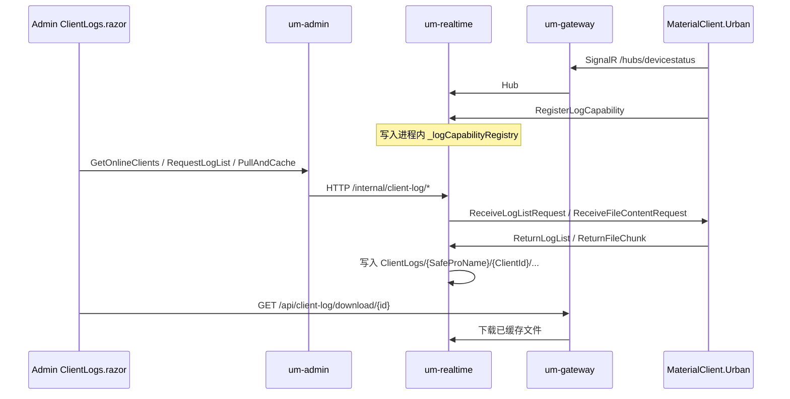

# 01 端到端链路

> 知识状态：`CONFIRMED`（2026-11-03 源码）

## 1. 角色

| 角色 | 进程 / 工程 | 职责 |
|------|-------------|------|
| MaterialClient.Urban | 工控桌面 | 连 Hub；注册日志能力；响应列表/文件请求；按 64KB 分片回传 |
| um-gateway | Gateway | 路由 Hub 与 client-log；拒绝 `/internal/**` |
| um-realtime | Realtime | Hub、能力字典、文件传输状态、`ClientLogAppService`、落盘 `ClientLogs/`、下载 API、internal API |
| um-admin | Admin | Blazor `ClientLogs.razor`；业务调用经 `RemoteClientLogAppService` HTTP 转发到 Realtime |

## 2. 启动与能力注册（客户端）

1. `MaterialClientUrbanModule` 在应用初始化时 **非阻塞** 调度 `ClientLogPullService.InitializeAsync()`。
2. 服务注册 `ReceiveLogListRequest` / 文件内容请求回调；订阅 `SignalRConnectionRestoredEventData`，重连后清 `_capabilityRegistered` 并重试注册。
3. `RegisterCapabilityAsync`：最多 5 次，间隔递增；需 `IDeviceStatusSignalRClient.IsConnected`。
4. 注册载荷 `LogCapabilityInfo`：`SupportsLogPull=true`，`LogDirectory` = `Log:Directory`（默认 `Logs`，相对 `AppContext.BaseDirectory`），`MaxConcurrentDownloads=3`，`ApiPort` 来自 `LocalLogApi:Port`（默认 5900），`LogFormatVersion=1.0`，另带 `ProName`（License）。
5. Hub：`RegisterLogCapability(clientId, capability, proName)` → Realtime 静态字典；同 `ClientId` 覆盖旧登记。

`ClientId`：配置 `Client:Id`，否则 `Environment.MachineName`；超过 100 字符截断。

## 3. 管理端操作路径

| UI 动作 | Admin 调用 | Realtime 行为 |
|---------|------------|----------------|
| 刷新在线客户端 | `GetOnlineClientsAsync` | `DeviceStatusHub.GetAllLogCapabilities()` |
| 查某日列表 | `RequestLogListAsync` | 向客户端发 `ReceiveLogListRequest`；等 TCS **30s** |
| 拉取选中文件 | `PullAndCacheAsync` | 每文件 `RequestFileContent` + 收分片；单文件 **120s**；写盘 |
| 按日一键拉 | `PullLogsByDateAsync` | 先列表再 `PullAndCache`（串行文件） |
| 浏览/删缓存 | Browse / Delete* | 操作 Realtime 磁盘 `ClientLogs/` |
| 下载 | 浏览器直达 `/api/client-log/download*` | `ClientLogController`（不经 Admin 转发） |

Admin 未托管 Realtime 时：`RemoteClientLogAppService` 替换 `IClientLogAppService`；`Hosting:RealtimeBaseUrl` 必填（缺则启动失败）。下载明确 `NotSupportedException`（走网关路径）。

## 4. 客户端响应

### 4.1 列表

- 校验 `targetClientId`；拒绝 `..` / 绝对路径的 `dateFolder`。
- `ClientLogScanner.Scan`：标准 `Logs/YYYY/MM/DD/`、遗留字面 `{YYYY}/{MM}/{DD}`、以及根目录含 `yyyyMMdd` 的 `.log`。
- `ReturnLogList` 回传。

### 4.2 文件

- 路径穿越与「必须落在 `_logBaseDirectory` 下」检查。
- `FileShare.ReadWrite` 打开；**64KB** 分片；`ReturnFileChunkAsync`；每 10 片延迟 10ms。
- 错误：`ReturnFileErrorAsync`。

说明：`MaxConcurrentDownloads` 注册给服务端，客户端发送侧未见按该值限流（`INFERRED`：字段目前主要是能力声明）。

## 5. 服务端缓存布局

- 根：`{ContentRoot}/ClientLogs`（容器内 `/app/ClientLogs`，volume `um-clientlogs`）。
- 现行：`ClientLogs/{SafeProName}/{ClientId}/...`
- 遗留只读：`ClientLogs/{ClientId}/...`（浏览路径可映射 `_legacy/...`）。
- 静态文件：Realtime 映射 `/ClientLogs`。

## 6. 超时与转发

| 环节 | 超时 |
|------|------|
| 列表等待 | 30s → `TimeoutException` |
| 单文件传输 | 120s |
| Admin→Realtime `HttpClient` | 30 分钟（覆盖按日多文件） |

Gateway（与 Phase 3 / 工程拆分一致）：

- Hub、`/api/app/client-log/**`、`/api/client-log/**`、`/ClientLogs/**` → `realtime`
- `/internal/**` → 网关 404（仅容器网 Admin→Realtime）

## 7. 与「上传」一词的对照

| 直觉说法 | 实际机制 |
|----------|----------|
| 客户端上传日志 | 服务端经 Hub **拉**；客户端是响应方 |
| 本地 5900 API 上传 | `ApiPort` 写入能力信息；**无**独立 LocalLog HTTP 上传实现（仅注册字段） |
| Admin 进程收文件 | 文件字节在 **Realtime**；Admin 只发命令 |
