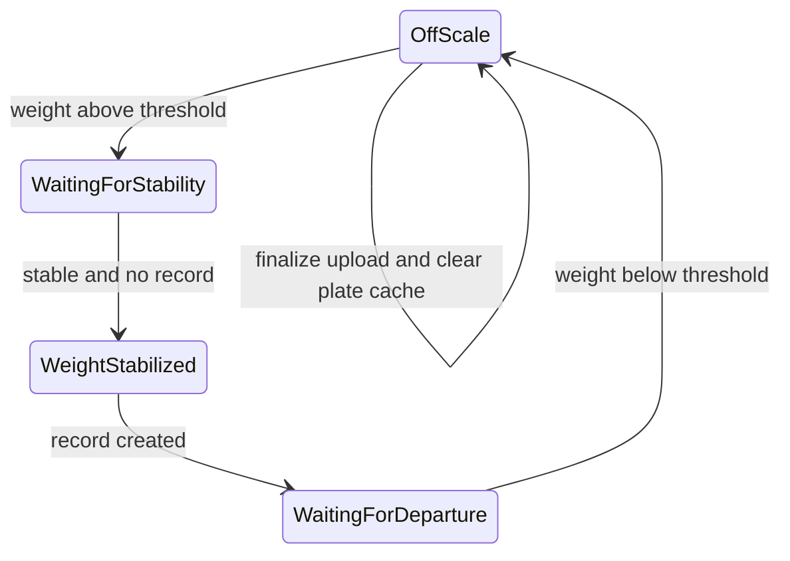

# 01 现行周期与上传门闩

> 知识状态：下列流程对照 2026-11-10 源码，标为 `CONFIRMED`，除非另行注明。

## 1. 一车一周期

新周期只从 `OffScale` 且重量超过 `MinWeightThreshold`（默认 0.5 吨）开始。稳定后创建 `WeighingRecord`，本周期持有 `recordId`，直到重量回到阈值以下并走完收口。

显示文案见 `AttendedWeighingStatusDisplay`：等待稳定 / 重量已稳定 / 等待下磅 / 称重已结束。

## 2. 状态强制停留（繁忙模式卡死点）

[`WeighingStreamPipeline.CreateStatusStream`](../../repos/MaterialClient/src/MaterialClient.Common/Services/AttendedWeighing/WeighingStreamPipeline.cs)：

- 已有 `recordId` 且 `weight > MinWeightThreshold` 时，`WeightStabilized` / `WaitingForDeparture` / `WaitingForStability` 一律压成 `WaitingForDeparture`。
- 只有 `WaitingForStability` 且 `stability.IsStable` 且 `recordId == null` 才会进入 `WeightStabilized`（再建下一单）。

因此：前车未下磅、后车已上磅 → 磅上重量持续高于阈值 → 第一单的 `recordId` 仍在 → 状态停在「等待下磅」→ **不会**再开第二单。

稳定判定本身见 [`WeightStabilityEvaluator`](../../repos/MaterialClient/src/MaterialClient.Common/Services/AttendedWeighing/WeightStabilityEvaluator.cs)：窗口内样本都高于阈值，且极差 ≤ `WeightStabilityThreshold * 2`。

## 3. 稳定时做什么 / 不做什么

[`AttendedWeighingService.OnWeightStabilizedAsync`](../../repos/MaterialClient/src/MaterialClient.Common/Services/AttendedWeighing/AttendedWeighingService.cs)：

1. 全摄像头抓拍  
2. `CreateWeighingRecordAsync` 建本地称重记录  
3. 稳定后附加抓拍  
4. `TryPublishMatchOnStableAsync`（见 §5）

Urban 扩展在建单侧效应里创建，默认同步态为 `WeighingInProgress`（[`UrbanWeighingExtension.CreateWeighingInProgress`](../../repos/MaterialClient/src/MaterialClient.Common.Urban/Services/Urban/UrbanWeighingExtensionService.cs)）。**稳定瞬间不升 `Pending`，不触发上传队列。**

## 4. 上传门闩：下磅收口

回到 `OffScale`（正常下磅，或稳定前/稳定后异常离磅）时，`ProcessStatusTransition` 调用 `RewriteAndResetCycleAsync`：

| 步骤 | 行为 | 路径 |
|------|------|------|
| 车牌/收发料重写 | 可按配置改写本单车牌 | `WeighingRecordService.TryReWritePlateNumberAsync` |
| 异常重算 + 升 Pending | `WeighingInProgress` → `Pending` | `UrbanWeighingRecordSideEffects.FinalizeWeighingCycleAsync` |
| 清车牌缓存 | `IPlateNumberService.ClearCache` | 同 `RewriteAndResetCycleAsync` |
| 重置周期 | `recordId` / 本周期 LPR 候选清空 | `WeighingStateManager.ResetCycle` |

[`FinalizeWeighingCycleAsync`](../../repos/MaterialClient/src/MaterialClient.Common.Urban/Services/UrbanWeighingRecordSideEffects.cs) 在收口时还会再拉一次最频繁车牌写回记录，再跑 `IUrbanAnomalyDetector`，然后才 `UpdateSyncStatusAsync(..., Pending)`。

结论：**上传门闩绑在「重量回到阈值以下」的收口链路上，不绑在「重量刚稳定」。**

## 5. 现有三个设置开关（解不了繁忙）

配置：[`WeighingConfiguration`](../../repos/MaterialClient/src/MaterialClient.Common/Configuration/WeighingConfiguration.cs)。  
界面：[`SettingsWindow.axaml`](../../repos/MaterialClient/src/MaterialClient.UI/Views/SettingsWindow.axaml)（启用车牌重写 / 启用最新车牌 / 稳定后立即匹配）。

| 开关 | 默认 | 实际作用 | 对繁忙模式 |
|------|------|----------|------------|
| `EnablePlateRewrite` | true | 下磅收口用最频繁车牌覆盖本单 | 仍等下磅 |
| `EnableLatestPlateNumber` | false | 推荐车牌时优先最近识别 | 仍等下磅 |
| `EnableMatchOnStable` | false | 稳定后发 `TryMatchEvent` | Urban [`ShouldSkipWaybillMatching`](../../repos/MaterialClient/src/MaterialClient.Urban/Services/UrbanWeighingPipelineStrategy.cs) 恒 true，事件被跳过；且**不**升 `Pending`、**不** `ResetCycle` |

## 5.1 车牌缓存不区分进出

地磅相机事件进入同一缓存。[`AttendedWeighingService`](../../repos/MaterialClient/src/MaterialClient.Common/Services/AttendedWeighing/AttendedWeighingService.cs) 只跳过非 `LprSiteType.Scale` 的设备；`LicensePlateRecognitionConfig.UrbanInOutType`（`Enter` / `Exit`）不参与选牌。

[`PlateNumberService.GetMostFrequentPlateNumber`](../../repos/MaterialClient/src/MaterialClient.Common/Services/AttendedWeighing/PlateNumberService.cs) 在高优先级颜色、20 分钟窗口内按次数或最近时间取一张。它还有推荐纠错和「挂」字过滤。[`PlateNumberValidator.IsValidChinesePlateNumber`](../../repos/MaterialClient/src/MaterialClient.Common/Providers/PlateNumberValidator.cs) 只验格式，选牌路径不调用它。

因此：出口 A、入口 B 两张真实牌会混在一个缓存里；误识别的另一张牌也会按次数或时间赢过磅上那一辆。格式合法不等于可靠。

## 6. 道闸（现行）

[`GateIoControlService`](../../repos/MaterialClient/src/MaterialClient.Common/Services/GateIoControlService.cs)：`WaitingForDeparture` 开出口道闸；`OffScale` 清理道闸会话。与上传门闩共用同一套状态边沿。

## 7. 源码索引

| 主题 | 路径 |
|------|------|
| 状态流 | `repos/MaterialClient/src/MaterialClient.Common/Services/AttendedWeighing/WeighingStreamPipeline.cs` |
| 稳定建单 / 下磅收口调度 | `.../AttendedWeighingService.cs` |
| 建单 / 稳定匹配 / RewriteAndReset | `.../WeighingRecordService.cs` |
| Urban Pending 升级 | `repos/MaterialClient/src/MaterialClient.Common.Urban/Services/UrbanWeighingRecordSideEffects.cs` |
| Urban 跳过运单匹配 | `repos/MaterialClient/src/MaterialClient.Urban/Services/UrbanWeighingPipelineStrategy.cs` |
| 异常规则 | `repos/MaterialClient/src/MaterialClient.Common/Services/UrbanAnomalyDetector.cs` |
| 称重配置 | `repos/MaterialClient/src/MaterialClient.Common/Configuration/WeighingConfiguration.cs` |
| 车牌缓存 | `repos/MaterialClient/src/MaterialClient.Common/Services/AttendedWeighing/PlateNumberService.cs` |
