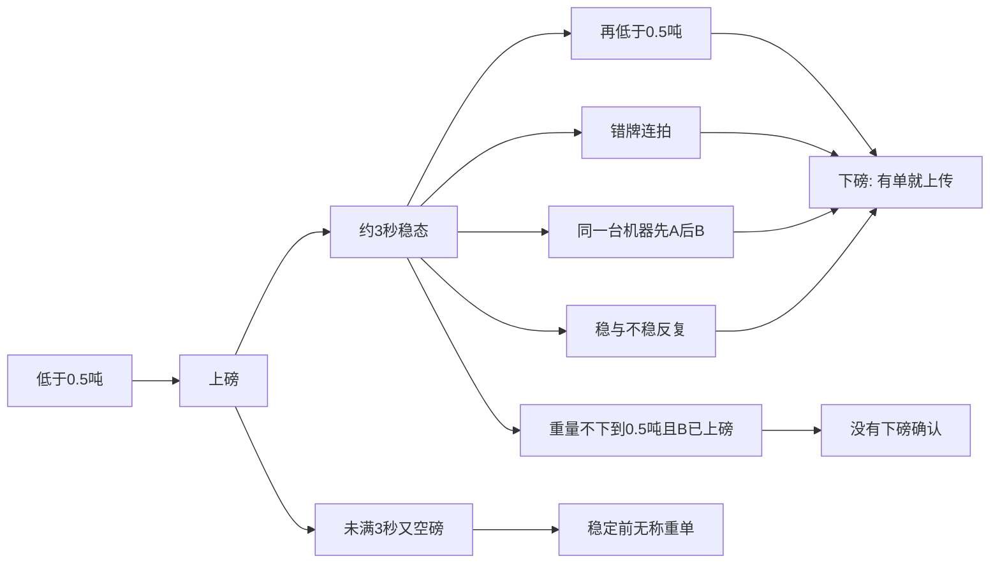
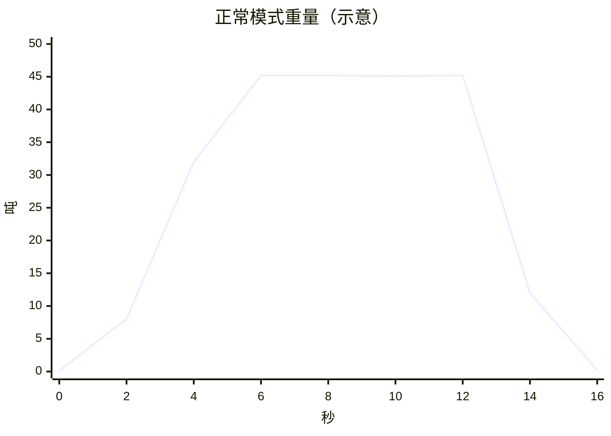
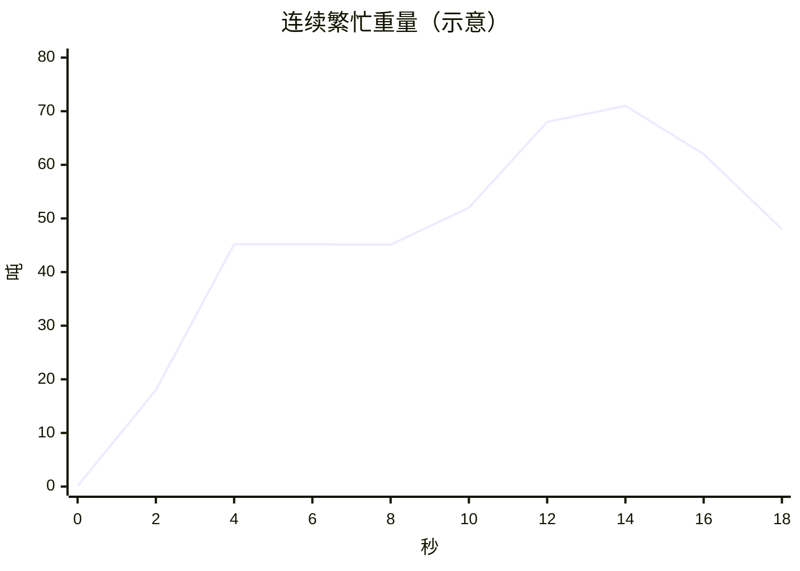

# 03 模式时序与图表

> 重量与车牌是**示意**，用来对齐模拟器场景。不是 `_tmp/1110/MaterialClient.db` 的采样。  
> 单车稳态的默认基准是约 45 吨（Human，2026-11-10）。日志里的实际吨数不替换这个基准。  
> 繁忙叠车没有地磅日志，也无法再提供。`B1` 仍用这条示意。  
> 阈值来自现行配置：空磅 `MinWeightThreshold = 0.5` 吨；稳定窗口默认约 3 秒，极差默认不超过 0.1 吨。  
> 状态：场景划分 `INFERRED`（由源码门闩 + Human 已知问题归纳）。本文件是预期，Graph 重放见 `02` §3.3。

横轴同一套：秒。车牌都来自**同一台识别机**，推送没有 `Enter` / `Exit`。

## 1. 汇总

| 模式 | 重量走势 | 车牌推送 | 以前的模式（下磅即上传） | 和异常的关系 |
|------|----------|----------|--------------------------|--------------|
| 正常 | 上磅 → 单车稳态 → 下到 0.5 吨以下 | 同一台机器重复推同一张牌 | 下磅后一张 `Pending` | 正常单也是下磅才传 |
| 异常·误识别 | 与正常相同的单车稳态 | 真牌夹杂错牌连拍 | 下磅后仍一张 `Pending`，牌是次数赢的那张 | 异常标记不挡上传 |
| 异常·双牌 | 单车或两车都压在磅上，重量仍稳定 | 同一台机器先后推 A 和 B | 下磅后仍一张 `Pending`，牌是缓存挑中的一张 | 两张牌都合法时，检测器通常还不记异常 |
| 异常·未稳就走 | 抬升后不到 3 秒又掉回 0.5 吨以下 | 牌未到，或只来一张 | 现行在稳定前不建单，没有可传的称重数据 | 不是「因为异常所以不传」 |
| 异常·重复稳定 | 稳态附近来回抖，多次越过「稳」边沿 | 同一张牌反复推 | 真正下磅时一张 `Pending` | 若改成每次稳定都传，才会打出多张单 |
| 连续繁忙 | A 的稳态还在，B 上来；中间重量可能一直高于 0.5 吨 | 同一台机器先推 A，再推 B | 没有下磅时，第一单不升 `Pending`，第二单不建 | 缺的是「有过车」的下磅确认，不是异常开关 |



## 2. 正常模式

一辆车。同一台识别机在上磅后和下磅前各推一次 `浙A11111`。重量离开 0.5 吨以下之后，只应有一笔上传。

重量（吨，示意）：



| 秒 | 重量 t | 相对 0.5 t | 车牌推送 | 现行状态 |
|----|--------|------------|----------|----------|
| 0 | 0.1 | 空磅 | — | `OffScale` |
| 2 | 8.0 | 已上磅 | 同一台机器 `浙A11111` | `WaitingForStability` |
| 4–10 | 约 45.2 持平 | 高于阈值且约 3 秒内极差很小 | 同一台机器再次 `浙A11111` | `WeightStabilized` 后转入 `WaitingForDeparture` |
| 14 | 12.0 | 仍高于阈值 | — | 仍等待下磅 |
| 16 | 0.2 | 空磅 | — | `OffScale`，收口升一张 `Pending` |

## 3. 异常模式

### 3.1 误识别

重量与正常模式相同。车牌在稳态里连拍错字。

| 秒 | 推送 | 说明 |
|----|------|------|
| 2 | `浙A11111` | 示意真牌 |
| 6 | `浙A11117` | 错一位，同一台机器连拍 3 次 |
| 8 | `浙A11111` | 真牌只再出现 1 次 |

次数规则会让 `浙A11117` 赢。下磅后这一笔仍然上传。异常标记不决定传不传。

### 3.2 同一台机器上的 A 与 B

重量可以停在单车稳态（示意约 45 吨）。一台识别机先后推出两张不同的牌，没有进出侧。

| 秒 | 推送 |
|----|------|
| 6 | `浙A11111`（前车） |
| 7 | `浙B22222`（后车） |

两张都格式合法。现行缓存并成一池，下磅后仍上传挑中的那张。异常标记不挡住这次上传。

### 3.3 未稳定就下磅

```mermaid
xychart-beta
  title "未稳就走（示意）"
  x-axis "秒" [0, 1, 2, 3]
  y-axis "吨" 0 --> 50
  line [0.1, 18.0, 31.0, 0.2]
```

2 秒时重量还在变，窗口不足约 3 秒。第 3 秒已低于 0.5 吨。牌可以还没到。称重单要到稳定才建，所以这次没有可升 `Pending` 的数据。这不是因为判了异常而扣下上传。

### 3.4 重复稳定

稳态附近抖动，`IsStable` 多次翻转。示意：45.2 → 45.0 → 45.3 → 44.9 → 45.2，全程高于 0.5 吨，极差大于 0.1 吨，牌仍是 `浙A11111`。

```mermaid
xychart-beta
  title "重复稳定（示意）"
  x-axis "秒" [6, 7, 8, 9, 10, 11, 12]
  y-axis "吨" 44 --> 46
  line [45.2, 45.0, 45.3, 44.9, 45.2, 45.2, 45.1]
```

以前的模式只在真正下磅时上传一笔，不因中间的稳/不稳抖动加单。若改成每个「再次稳定」都上传，同一段在磅会打出多张重量接近的单。

## 4. 连续繁忙模式

前车还在磅上，后车已经上来。现场可能出现两车之间的重量一直高于 0.5 吨、没有空磅（Human，2026-11-10）。同一台识别机先推前车牌，再推后车牌。前车稳态取约 45 吨。后半段升到约 70 吨，表示部分叠压，中间仍高于 0.5 吨。两车若都能整车停在 9～10 m 上，活读数会靠近约 90 吨；车身能否同时整车在磅上没有测量。下面这条曲线是这种「中间不落到 0.5 吨」的示意，不是每次繁忙都会这样。



| 秒 | 重量 t | 车牌推送 | 含义 |
|----|--------|----------|------|
| 0 | 0.1 | — | 空磅 |
| 4–8 | 约 45.2 | 同一台机器 `浙A11111` | A 停稳。若此时建单，单上重量是这一窗的中点 |
| 10 | 52.0 | 同一台机器 `浙B22222` | B 开始上磅，活读数离开约 45 吨，仍是这一台机器 |
| 12–14 | 约 70 | 仍可能再推 A 或 B | 部分叠压，没有空磅边沿。单上重量仍是约 45 吨 |
| 18 | 48.0 | — | 仍高于 0.5 吨。现行不结束 A，也不建 B |

以前的模式要等重量低于 0.5 吨才确认有过车并上传。中间若一直高于 0.5 吨，第一单不升 `Pending`，第二单也不建。缺的是下磅确认，不是异常是否放行。

## 5. 模拟器场景编号

| 编号 | 模式 | 重量曲线 | 车牌推送 | 以前的模式 |
|------|------|----------|----------|------------|
| N1 | 正常 | §2 | 同一台机器重复推同一张牌 | 下磅后一笔 `Pending`，牌为 `浙A11111` |
| E1 | 异常·误识别 | 同 N1 | §3.1 错牌次数更多 | 下磅后仍一笔 `Pending`，牌是次数赢的那张 |
| E2 | 异常·双牌 | 单车稳态 | §3.2 A 与 B | 下磅后仍一笔 `Pending`，牌是缓存挑中的一张 |
| E3 | 异常·未稳就走 | §3.3 | 可无牌 | 稳定前无称重单，没有可传数据 |
| E4 | 异常·重复稳定 | §3.4 | 同一张牌多次 | 真正下磅时一笔 `Pending` |
| B1 | 连续繁忙 | §4 中间可能不低于 0.5 吨 | 同一台机器先 A 后 B | 没有下磅，不上传 |

示意牌 `浙A11111`、`浙A11117`、`浙B22222` 只用于这张表，不是现场车牌。

开关原样打开时每一行会打出什么，见 [`07-直接上现场的后果.md`](07-直接上现场的后果.md)。那里多一个 E5：稳定时还没有牌。
