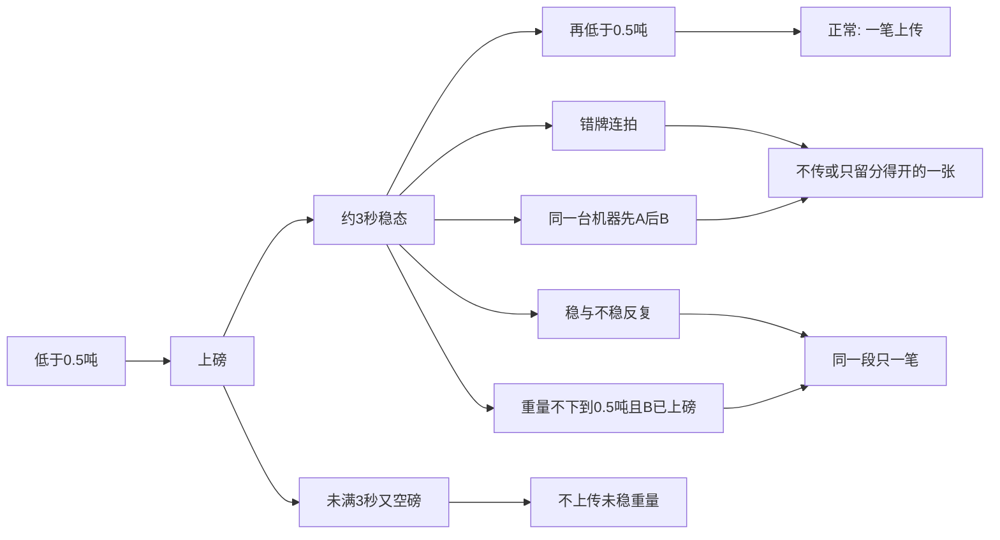
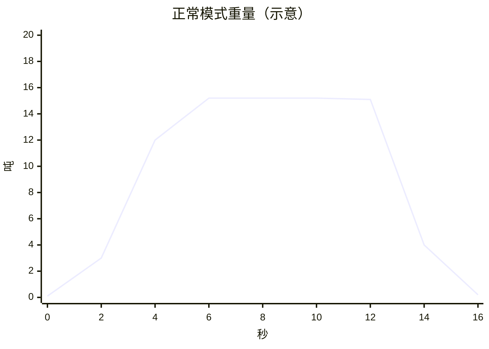
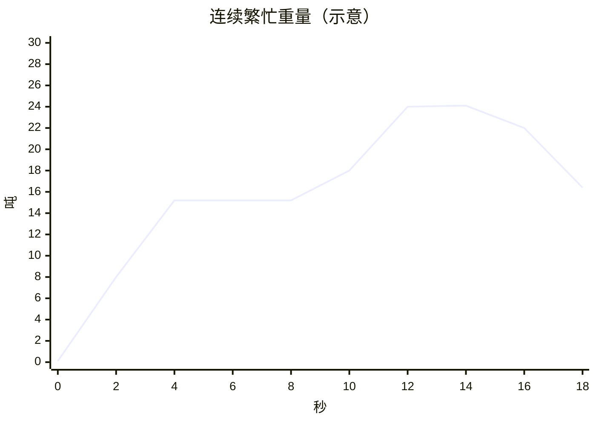

# 03 模式时序与图表

> 重量与车牌是**示意**，用来对齐模拟器场景。不是 `_tmp/1110/MaterialClient.db` 的采样。  
> 阈值来自现行配置：空磅 `MinWeightThreshold = 0.5` 吨；稳定窗口默认约 3 秒。  
> 状态：场景划分 `INFERRED`（由源码门闩 + Human 已知问题归纳）。

横轴同一套：秒。车牌都来自**同一台识别机**，推送没有 `Enter` / `Exit`。

## 1. 汇总

| 模式 | 重量走势 | 车牌推送 | 现行结果 | 模拟器要判定的事 |
|------|----------|----------|----------|------------------|
| 正常 | 上磅 → 单车稳态 → 下到 0.5 吨以下 | 同一台机器重复推同一张牌 | 下磅后一张 `Pending` | 只上传这一张牌、这一笔稳态 |
| 异常·误识别 | 与正常相同的单车稳态 | 真牌夹杂错牌连拍 | 次数多的那张会赢 | 错牌不得压过真牌；分不开则不传 |
| 异常·双牌 | 单车或两车都压在磅上，重量仍稳定 | 同一台机器先后推 A 和 B | 两张牌进同一缓存 | 两张都可信时不绑定、不上传 |
| 异常·未稳就走 | 抬升后不到 3 秒又掉回 0.5 吨以下 | 牌未到，或只来一张 | 异常离磅收口，常为空牌 | 不把未稳重量当成一笔上传 |
| 异常·重复稳定 | 稳态附近来回抖，多次越过「稳」边沿 | 同一张牌反复推 | 若每次稳定都上传，会打出多张单 | 同一段在磅只留一张 `Pending` |
| 连续繁忙 | A 的稳态还在，B 上来，重量不下到 0.5 吨 | 同一台机器先推 A，再推 B | 停在等待下磅，第一单不升 `Pending`，第二单不建 | 没有空磅边沿就不再开下一单 |



## 2. 正常模式

一辆车。同一台识别机在上磅后和下磅前各推一次 `浙A11111`。重量离开 0.5 吨以下之后，只应有一笔上传。

重量（吨，示意）：



| 秒 | 重量 t | 相对 0.5 t | 车牌推送 | 现行状态 |
|----|--------|------------|----------|----------|
| 0 | 0.1 | 空磅 | — | `OffScale` |
| 2 | 3.0 | 已上磅 | 同一台机器 `浙A11111` | `WaitingForStability` |
| 4–10 | 15.2 持平 | 高于阈值且约 3 秒内极差很小 | 同一台机器再次 `浙A11111` | `WeightStabilized` 后转入 `WaitingForDeparture` |
| 14 | 4.0 | 仍高于阈值 | — | 仍等待下磅 |
| 16 | 0.2 | 空磅 | — | `OffScale`，收口升一张 `Pending` |

## 3. 异常模式

### 3.1 误识别

重量与正常模式相同。车牌在稳态里连拍错字。

| 秒 | 推送 | 说明 |
|----|------|------|
| 2 | `浙A11111` | 示意真牌 |
| 6 | `浙A11117` | 错一位，同一台机器连拍 3 次 |
| 8 | `浙A11111` | 真牌只再出现 1 次 |

次数规则会让 `浙A11117` 赢。模拟器在两张都像真牌、又分不开进出侧时，结果应是不上传。

### 3.2 同一台机器上的 A 与 B

重量可以停在单车稳态（示意 15.2 吨）。一台识别机先后推出两张不同的牌，没有进出侧。

| 秒 | 推送 |
|----|------|
| 6 | `浙A11111`（前车） |
| 7 | `浙B22222`（后车） |

两张都格式合法。现行缓存并成一池。模拟器不得挑一张绑定。

### 3.3 未稳定就下磅

```mermaid
xychart-beta
  title "未稳就走（示意）"
  x-axis "秒" [0, 1, 2, 3]
  y-axis "吨" 0 --> 8
  line [0.1, 4.0, 6.5, 0.2]
```

2 秒时重量还在变，窗口不足约 3 秒。第 3 秒已低于 0.5 吨。牌可以还没到。现行走异常离磅。模拟器不把 6.5 吨升成 `Pending`。

### 3.4 重复稳定

稳态附近抖动，`IsStable` 多次翻转。示意：15.2 → 15.0 → 15.3 → 14.9 → 15.2，全程高于 0.5 吨，牌仍是 `浙A11111`。

```mermaid
xychart-beta
  title "重复稳定（示意）"
  x-axis "秒" [6, 7, 8, 9, 10, 11, 12]
  y-axis "吨" 14 --> 16
  line [15.2, 15.0, 15.3, 14.9, 15.2, 15.2, 15.1]
```

若每个「再次稳定」都上传，同一段在磅会打出多张重量接近的单。模拟器只保留第一笔 `Pending`，直到看见低于 0.5 吨的空磅。

## 4. 连续繁忙模式

前车还在磅上，后车已经上来。重量不下到 0.5 吨。同一台识别机先推前车牌，再推后车牌。



| 秒 | 重量 t | 车牌推送 | 含义 |
|----|--------|----------|------|
| 0 | 0.1 | — | 空磅 |
| 4–8 | 15.2 | 同一台机器 `浙A11111` | A 停稳 |
| 10 | 18.0 | 同一台机器 `浙B22222` | B 开始上磅，仍是这一台机器 |
| 12–14 | 约 24 | 仍可能再推 A 或 B | 两车都压在磅上，没有空磅边沿 |
| 18 | 16.4 | — | 仍高于 0.5 吨。现行不结束 A，也不建 B |

这一段的期望：A 在首次稳态最多一笔；B 的牌出现、重量变成合重时，不再开第二张 `Pending`。下一单要等重量先回到 0.5 吨以下。

## 5. 模拟器场景编号

| 编号 | 模式 | 重量曲线 | 车牌推送 | 期望 |
|------|------|----------|----------|------|
| N1 | 正常 | §2 | 同一台机器重复推同一张牌 | 一笔 `Pending`，牌为 `浙A11111` |
| E1 | 异常·误识别 | 同 N1 | §3.1 错牌次数更多 | 不上传 |
| E2 | 异常·双牌 | 单车稳态 | §3.2 A 与 B | 不上传 |
| E3 | 异常·未稳就走 | §3.3 | 可无牌 | 不上传 |
| E4 | 异常·重复稳定 | §3.4 | 同一张牌多次 | 只有一笔 `Pending` |
| B1 | 连续繁忙 | §4 | 同一台机器先 A 后 B | A 最多一笔；合重段不再开单 |

示意牌 `浙A11111`、`浙A11117`、`浙B22222` 只用于这张表，不是现场车牌。
