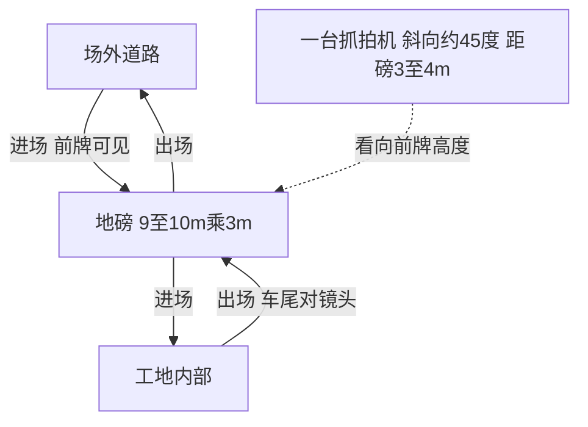

# 04 现场布局

> Human，2026-11-10。下面是现场说明的示意图，不是测量图。  
> 长度、距离用给出的范围。抓拍机高度只知道高于车牌，没有米数。

## 1. 平面

地磅在工地入口。车的行驶方向和长边平行：长 9～10 m 是进出方向，宽 3 m 是横向。抓拍机在工地内侧、磅的侧前方，视线相对长边大约斜 45°，离磅 3～4 m，安装高度高于车牌。

进场时车沿长边开向工地，车头朝抓拍机，前牌可见。出场时车沿同一条长边开向场外，车尾朝抓拍机。

```text
                      工地内部
                          ^
                          | 进场：沿长边，车头朝内，前牌朝向抓拍机
                          |
          抓拍机 *        |
                 \        |
                  \ 约 45°，距磅 3～4 m，高于车牌
                   \      |
                    +----+
                    |    |
                    |    |
                    | 长 |
                    | 9  |
                    | ~  |
                    | 10 |
                    | m  |
                    |    |  <- 宽 3 m
                    |    |
                    +----+
                          |
                          | 出场：沿同一条长边，车头朝外，车尾朝向抓拍机
                          v
                      场外道路
```

只有这一台抓拍机。推送里没有第二台机器，也没有 `Enter` / `Exit` 标记。软件配置里的 `UrbanInOutType` 在这里填不上第二侧。

## 2. 两种过磅朝向

进出都可能上磅。同行不需要出场数据。

| 方向 | 车相对抓拍机 | 车牌 | 数据 |
|------|----------------|------|------|
| 进场 | 车头朝向抓拍机 | 通常能拍到前牌 | 需要 |
| 出场 | 车尾朝向抓拍机 | 通常拍不到牌 | 不需要。偶尔拍到并上传，也没有影响 |



## 3. 和选牌的关系

连续繁忙时，前车还在磅上、后车已经靠近，两张牌仍来自这一台机器。布局解释了为什么出场常常没有牌，但不提供进出方向字段。

模拟器场景继续用单机序列。出场偶发的一张牌可以出现在输入里，判定上它不改变「同行不需要出场数据」：传上去也不当作必须拦住的错误。进场前牌仍是要上传的那一笔。
