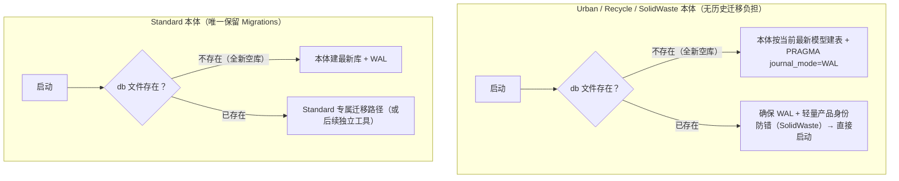

# 01 · 现状盘点与收敛后的极简隔离方案

## 一、当前迁移与升级代码盘点（16 个项目）

| 现存位置 | 当前状态 | 按 D1–D5 决策后的处置 |
|---|---|---|
| `src/MaterialClient.Toolkit/` | 旧 CSV / 加密库导入工具 | **直接移除**（D3：已淘汰不再使用） |
| `src/MaterialClient.DatabaseUpgrade/` | 固废独立升级工具 | **退役移除**（D5：固废现场已升级完毕，后续无升级需求） |
| `src/MaterialClient.Common.EntityFrameworkCore/SqliteMigrationHistoryMigrator.cs` | 所有宿主启动均执行 `__EFMigrationsHistory` 重命名 | **移出通用启动路径**，仅在 Standard 需要迁移旧库时调用（D2 / D4） |
| `src/MaterialClient.Common/Hosting/DeploymentPreflight.cs` `src/MaterialClient.Common/Hosting/SupportedSchemaManifest.cs` | 校验 Standard / SolidWaste 迁移基线与固废 `UpgradeRequired` | 去掉固废升级期专用分支（D5），保留最轻量的产品身份防错保护即可（防止 Standard 与 SolidWaste 互开对方库） |
| `src/MaterialClient.Urban/MaterialClientUrbanModule.cs` `src/MaterialClient.Recycle/MaterialClientRecycleModule.cs` `src/MaterialClient.SolidWaste/MaterialClientSolidWasteModule.cs` | 启动调用 `KernelDatabaseMigrator.MigrateAsync` + 产品 `MigrateAsync` | **极简启动**：空库时由本体按当前模型建库 + `WAL`（D1）；已有库直接运行，不再跑增量 `Migrations` 与 legacy 兼容（D2 / D4 / D5） |
| `src/MaterialClient/MaterialClientModule.cs`（Standard） | 启动调用内核 + Standard `MigrateAsync` | **唯一保留 `Migrations` 的产品**（D4）；可选进一步将旧库升级抽到独立 Standard 迁移工具 |

## 二、收敛后的目标架构边界

### 各产品职责一目了然

| 产品 | 全新空库创建 | 增量 EF `Migrations` | 历史表兼容 / 独立升级程序 |
|---|---|---|---|
| **Urban** | 本体创建 + WAL | **不需要** | **不需要** |
| **Recycle** | 本体创建 + WAL | **不需要** | **不需要** |
| **SolidWaste** | 本体创建 + WAL | **不需要**（现场已升级完） | **不需要**（`DatabaseUpgrade` 可退役） |
| **Standard** | 本体创建 + WAL | **保留**（唯一使用者） | 仅 Standard 保留最小兼容；后续如需彻底剥离可单拆 |

## 三、推荐实施顺序（拆为清晰的小 OpenSpec Change）

### Change 1：`remove-retired-migration-tools`（S 级，优先做减法）
- 从 `MaterialClient.sln` 和 `src/` 删除 `MaterialClient.Toolkit` 与 `MaterialClient.DatabaseUpgrade`（及其对应无效引用/测试）。
- 效果：项目数立减 2 个，彻底清除两套不再维护的迁移工具代码。

### Change 2：`simplify-non-standard-db-bootstrap`（M 级，核心瘦身）
- 将 `KernelDatabaseMigrator` 拆清晰：
  - **非 Standard 宿主（Urban / Recycle / SolidWaste）**：空库时直接按最新模型创建表 + 开启 `WAL`（`EnsureCreated` / `IRelationalDatabaseCreator.CreateTables` + `EnsureWalJournalModeAsync`），不走 `SqliteMigrationHistoryMigrator.RenameLegacyHistoryTableIfNeededAsync`，不再维护产品侧增量 `Migrations/`。
  - **Standard 宿主**：继续独占 `KernelDatabaseMigrator` + `StandardDbContext` 的 `Migrations/` 路径。
- 精简 `DeploymentPreflight` 与 `SupportedSchemaManifest`：移除固废 `UpgradeRequired` 与 `SolidWasteLegacyFieldsMigration` 历史升级判断，仅保留 Standard ↔ SolidWaste 产品身份互斥检查（防误开库）。

### Change 3（可选）：`isolate-standard-migrations`（M 级，按需）
- 若希望 Standard 本体也做到零迁移残留，再单独把 Standard 的历史 `Migrations` 移到极轻量的单文件 CLI 升级工具中；若 Standard 已进入维护期、几乎不再改表，可暂缓此步以节省成本。

## 四、风险与注意事项

1. **多 Context 同库首次建表顺序（Urban / Recycle / SolidWaste）**：
   - 在空库上用 `EnsureCreated()` 时注意 EF Core 的坑：第一个 DbContext（`MaterialClientDbContext`）调用 `EnsureCreated()` 会建库并建内核表；第二个 DbContext（如 `UrbanDbContext`）若调 `EnsureCreated()` 会因库已有表而跳过建表，**必须使用 `IRelationalDatabaseCreator.CreateTables()`**（并在建表前判断目标表是否已存在，或在全新空库时连续对 Kernel + Product 调用 `CreateTables()`），最后统一 `PRAGMA journal_mode = WAL;`。
   - 本仓库 `MaterialClientEntityFrameworkCoreTestModule.cs` 中已有 `IRelationalDatabaseCreator.CreateTables()` 的成熟用法可直接参考。
2. **存量测试/打包脚本**：
   - 移除 `MaterialClient.Toolkit` 和 `MaterialClient.DatabaseUpgrade` 前需检查 `scripts/`、`.github/`、installer 脚本中是否还有引用。
3. **归档保留历史**：
   - 已被删除的 `DatabaseUpgrade` / `Toolkit` 完整代码永久保留在 git 历史与已归档 OpenSpec 中，未来若有极端回溯需求可随时从 git tag 恢复。
