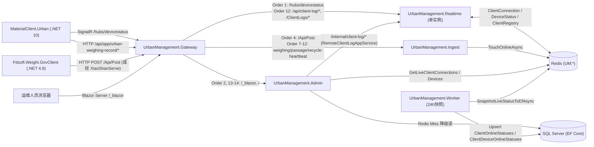

# 01 - 现状架构与协议对齐分析

本文档基于当前源码核对结果（知识状态：`CONFIRMED`），梳理 **MaterialClient.Urban**（新客户端）、**UrbanManagement**（服务端与 Admin）、**Fdsoft.Weight.GovClient**（老客户端）以及 **MaterialClient.Recycle**（对照项）在客户端管理领域的实际实现与协议对齐情况。

---

## 1. 整体部署与通信拓扑

`UrbanManagement` 采用多角色容器部署（`repos/UrbanManagement/deploy/docker/compose.yaml`），经由 `UrbanManagement.Gateway`（YARP）按路径分发：

关键拓扑约束（`CONFIRMED`）：
- **`UrbanManagement.Realtime` 强绑定单实例**：`DeviceStatusHub`（`repos/UrbanManagement/src/UrbanManagement.Core/Hubs/DeviceStatusHub.cs:17`）与 `ClientLogAppService`（`repos/UrbanManagement/src/UrbanManagement.Core/Services/ClientLogAppService.cs:37-44`）将连接映射、日志能力注册表（`_logCapabilityRegistry`）、待完成请求（`PendingRequests`）和文件分片缓冲区（`_pendingFileBuffers`）保存在进程内 `static` 字典中。
- **Admin 跨进程代理日志操作**：`UrbanManagement.Admin` 将 `IClientLogAppService` 替换为 `RemoteClientLogAppService`（`repos/UrbanManagement/src/UrbanManagement.Admin/Services/RemoteClientLogAppService.cs:26-41`），通过内网调用 `um-realtime` 的 `/internal/client-log/*`（该路径在 Gateway 被 `404` 拦截，`Gateway/Program.cs:16-25`）。
- **Admin 页面无实时推送**：依据 `openspec/specs/project-client-merge/spec.md` 与 `urban-signalr-hub-resilience/spec.md`，`ProjectManagement.razor` 不建立 `/hubs/devicestatus` 浏览器连接，也不做 30s 定时轮询，仅在页面加载或手动刷新时通过 AppService 读 Redis（Miss 时降级读 EF）。

---

## 2. 三端客户端能力与协议对齐矩阵

| 维度 | MaterialClient.Urban（新客户端） | UrbanManagement（Admin / 服务端） | Fdsoft.Weight.GovClient（老客户端） | MaterialClient.Recycle（对照） |
|------|-----------------------------------|--------------------------------------|-------------------------------------|--------------------------------|
| **通信协议** | SignalR `/hubs/devicestatus` + HTTP 业务上报 | SignalR Hub + HTTP Ingest + Blazor Admin | **纯 HTTP POST**（无 SignalR 包） | 仅 HTTP 业务上报（未配置/未启动 SignalR） |
| **身份标识（`ClientId`）** | 设备上报硬编码 `Environment.MachineName`；日志注册读 `Client:Id ?? MachineName`（**分裂**） | 复合键 `(ProId, ClientId)`；`ClientId` 最长 100 字符 | 无 `ClientId`；服务端合成 `legacy:{AccessCode}` | 仅 `RecycleDeviceStatus` 用 `DeviceId` |
| **项目标识（`ProId`）** | `ILicenseService.GetCurrentLicenseAsync().ProjectId` | `GovProject.SourceProId`（Urban 与 `Id` 相同；Recycle 不同） | 激活时拿到 `Proid` 后**丢弃**，仅传 `buildLicenseNo` | `SourceProId`（产品码 `5020`） |
| **版本与主机元数据** | **未上报**（`.csproj` 甚至未定义 `<Version>`）；`MachineCode` 仅本地校验未上报 | 实体/DTO/缓存均**无 `AppVersion`、`MachineName`、`ClientKind` 字段** | **无版本号、无主机名、无 MAC** | 无 SignalR 元数据 |
| **心跳保活机制** | **无定时心跳**；仅设备状态翻转时发 `UploadStatus` | **无 `Heartbeat` RPC**；仅靠 `UploadStatus` 或称重 `ReceiveAsync` 调用 `TouchOnlineAsync` | 萧山 1（`networkCompany=3`）与电信模式**关闭心跳定时器**；仅联通/Debug 每 59s POST `heartbeat` | 独立 HTTP 接口 `POST /api/app/recycle-device-status/record-heartbeat`（90s 超时） |
| **设备在线上报** | `Scale`(2s)、`Printer`(5s)、`LPR`(30s)、`Sound`(30s)、`Camera`(仅启动1次)；**缺 `GateIO`** | 接受 5 类：`Scale`、`Camera`、`LPR`、`Sound`、`Printer`；展示在项目页「设备」弹窗 | **完全无网络上报**（仅本地 WinForms 状态灯 + 1s TCP Telnet 探活） | `SharedDeviceStatusTracker` 在跑但 SignalR 未启动，消息堆积在内存队列 |
| **日志远程拉取** | `ClientLogPullService` 支持 SignalR 分片拉取（64KB/片），但默认 `Client:Id=""` 导致**不注册** | `/client-logs` 页面经 `RemoteClientLogAppService` → `DeviceStatusHub` 拉取并缓存至 `ClientLogs/` | **完全无**（仅本地 log4net + 6 个月清理） | **无** `ClientLogPullService` |
| **鉴权与安全** | `SignalR:AccessToken` 默认为空；不传自定义 Header | `DeviceStatusHub` **无 `[Authorize]`**；Gateway 将 `/api/client-log/*`、`/ClientLogs/*` 直通无鉴权的 `realtime` | 无 Token（激活时的 `AuthToken` 被丢弃），`/Api/Post` `[AllowAnonymous]` | HMAC 签名认证（独立于 Urban） |

---

## 3. 核心存储模型与 TTL 机制核对

### 3.1 Redis 键空间（`UrbanManagementCoreModule.cs:62-77`，前缀 `UM:`）

| 缓存类型 | CacheName | Key 规则 | 写入入口 | 实际 TTL（以当前 `appsettings.json` 为准） |
|----------|-----------|----------|----------|----------------------------------------------|
| 连接状态 | `ClientConnection` | `{proId}:{clientId}` | `UpsertClientConnectedAsync` / `TouchOnlineAsync` / `UpsertClientDisconnectedAsync` | 在线：`max(60, ClientTimeoutIntervalSeconds)*2` = **7200s（2h）**（因 `appsettings.json:59` 覆写为 `3600`）；`legacy:*` = **30m**；离线 = **7d** |
| 连接索引 | `ClientRegistry` | `__connection_registry__` | 同上 | **7d**（`OfflineRetentionDays`） |
| 设备状态 | `DeviceStatus` | `{proId}`（空则回退 `{clientId}`） | `HandleStatusUploadAsync` / `MarkInstanceDevicesOfflineInCacheAsync` | 写入时用 Live TTL（2h）；断线标离线时延至 **7d** |
| 设备索引 | `ClientRegistry` | `__registry__` | 同上 | 写入时用 Live TTL（2h） |

### 3.2 数据库表（`UrbanManagementDbContext` & `RecycleDbContext`）

- **`GovProjects`**：主数据表，来源于 BasePlatform 同步（`GovProjectPullManager`）。关键字段：`Id`、`SourceProId`、`ProductCode`（`5001`=Urban，`5020`=Recycle）、`AccessCode`、`MachineCode`、`AuthEndTime`、`LastSyncTime`。
- **`ClientOnlineStatuses`**：EF 快照表，唯一索引 `(ProId, ClientId)`。字段：`ProId`、`ClientId`、`ProName`、`IsConnected`、`ConnectedAt`、`DisconnectedAt`、`LastSeenAt`、`Slot`（预留未用）。
- **`ClientDeviceOnlineStatuses`**：EF 设备快照表，唯一索引 `(ProId, ClientId, DeviceType)`。字段：`ProId`、`ClientId`、`DeviceType`、`Status`、`LastUpdateTime`、`AdditionalData`（上限 2000 字符，目前客户端从未填充）。
- **`DeviceStatusLog`**：实体类存在（`Entities/DeviceStatusLog.cs`），**未注册到 `DbContext`**，无状态变更历史留痕。
- **`RecycleDeviceStatuses`**（`RecycleDbContext`）：独立表，唯一索引 `(ProId, DeviceId)`，仅记录 `LastSeenAtUtc`，以 90s 阈值动态计算 `Online`/`Offline`/`Unknown`。**经源码核对，`MaterialClient` 从未调用过其 `RecordHeartbeatAsync` 接口**，该链路与 `/recycle/device-status` 页面实为未接入的并行空壳；按「非称重客户端维护统一」原则，后续应废除并统一回 `DeviceStatusHub` / `ClientOnlineStatuses` 体系。

### 3.3 写入与读取路径的不对称性

- **热路径只写 Redis**：`DeviceStatusHub` 的连接、断线、`UploadStatus` 以及 `UrbanWeighingRecordAppService.ReceiveAsync` 均只写 Redis，不触碰 EF（符合 `device-online-status-persistence` 与 `urban-signalr-hub-resilience` 规范）。
- **冷路径 24 小时快照**：`ClientStatusSnapshotBackgroundWorker`（`UrbanManagementWorkerModule.cs:55-67`）每隔 **24 小时**（`RunOnStart = false`）将**彼时仍存在于 Redis 中的键**批量 Upsert 到 EF。
- **读取合并口径分裂**：
  - `GetLiveClientConnectionsAsync`（`DeviceStatusService.cs:450-472`）：Redis 优先；Redis Miss 时从 EF 兜底，但通过 `FromEntityAsOfflineFallback` **强制置 `IsConnected = false`**。
  - `GetLiveClientDevicesAsync`（`DeviceStatusService.cs:499-518`）：Redis 优先；Redis Miss 时从 EF 兜底，但直接用 `ClientDeviceSummaryDto.FromEntity(row)` **保留了 EF 快照里的 `Status = "Online"`**。

---

## 4. 既有 `openspec/specs/` 与实际代码的漂移核对

| 规范文件 | 规范要求（SHALL） | 实际代码现状 | 漂移性质 |
|----------|-------------------|--------------|----------|
| `signalr-device-status-upload/spec.md` | JWT Bearer 鉴权（401）；客户端每设备 1 msg/s 节流；`ReturnLogList` 广播 `LogListReceived` | `DeviceStatusHub` 无 `[Authorize]`；客户端 `AccessToken` 为空；`DeviceStatusEventHandler` 节流判断后未 `return`（空转）；服务端实际广播 `LogListResponse` | 实现缺口 + 命名漂移 |
| `client-log-local-api/spec.md` | 本地 Kestrel `127.0.0.1:5900` 提供 `/api/local-log/download` 与 `/list` | 代码中已全面转向 SignalR 分片拉取，无本地 5900 HTTP 服务，仅残留 `LogCapabilityInfo.ApiPort = 5900` 死字段 | 规范已过时（历史演进残留） |
| `legacy-api-compat/spec.md` | 描述 `/Api/Post` 仍为 WIP 返回 501 且不落库、禁止查询 `FdBuildLicenseNo` | `LegacyApiController.Post` 已完整委托 `LegacyGovSyncAppService` 落库并 Touch `legacy:{AccessCode}`，且仍支持 `fdBuildLicenseNo` 回退匹配 | 规范落后于代码实现 |
| `device-online-status-persistence/spec.md` | 禁止新增专用 `Ping/Heartbeat` RPC，靠 `UploadStatus` 续期 | 实际客户端仅在状态翻转时发 `UploadStatus`，稳态下无任何上行，导致**规范假设与实际流量模型矛盾** | 规范设计盲区 |
| `urban-signalr-hub-resilience/spec.md` | `ClientTimeoutInterval` 默认 60s（> `KeepAliveInterval` 15s） | `UrbanManagement.Hosting/appsettings.json:59` 将其覆写为 `3600`（1 小时） | 运行配置偏离设计预期 |
