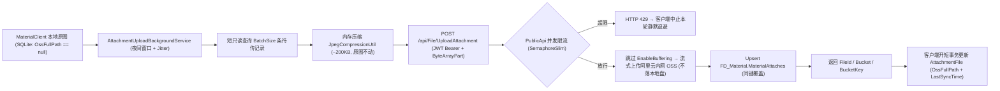

# 技术设计：客户端移除 OSS 并改为经 FdSoft.Material.PublicApi 低峰上传

## Context

当前运单附件（进场照片 `EntryPhoto=1`、出场照片 `ExitPhoto=2`、票据照片 `TicketPhoto=3`）的同步路径为：

1. `MaterialClient` 后台每 10 分钟在 `PollingBackgroundService` 中串行执行同步，最后一步在单个 `[UnitOfWork]` 内调用 `IAttachmentService.SyncPendingAttachmentsToOssAsync()`。
2. 客户端使用本地 `AliyunOss` 密钥通过 `Aliyun.OSS.SDK.NetCore` 直传阿里云 OSS，再逐条调用 `POST /api/File/UpdateAttaches` 写入 `FD_Material.MaterialAttaches`。
3. 现场工地电脑 **24 小时常开**，图片同步允许延迟约 **10 小时**，核心诉求是：**客户端彻底移除 OSS 凭据与 SDK、服务器本地不保存图片、上传图片压缩至约 200KB、白天不阻塞称重与业务接口**。

## Goals / Non-Goals

### Goals

- 客户端彻底移除 OSS SDK、配置与直传代码，不再持有任何 OSS AK/SK 或 Bucket 信息。
- `FdSoft.Material.PublicApi` 提供受 JWT `[Authorize]` 保护的流式上传接口，内存直转阿里云内网 OSS（服务器本地零落盘）并同步写 `MaterialAttaches` 表。
- 客户端在上传前纯内存将图片压缩至约 200KB（不改动本地留存原图），显著降低公网入站带宽与服务端压力。
- 将自动上传拆出 `PollingBackgroundService`，通过夜间低峰窗口 + 随机抖动 + 短事务 + 服务端并发限流（`429`），保证白天对客户端 SQLite、工地网络与 `PublicApi` 核心业务 0 阻塞。
- 重复上传同一 `(BizId, BizType, FileName)` 时支持覆盖 OSS 对象并更新数据库记录。

### Non-Goals

- 不改动 `MaterialClient.Urban`（走 `UrbanManagement` tus/multipart）和 `MaterialClient.Recycle` 的附件上传通道。
- 不删除 `FdSoft.Material.PublicApi` 原有的 `POST /api/File/UpdateAttaches` / `AddAttaches`，保持对老版本客户端的向后兼容。
- 不修改客户端 SQLite `AttachmentFile` 表结构（继续复用 `OssFullPath` 与 `LastSyncTime` 列）。
- 本次不引入 STS 临时凭证或预签名直传（保持架构边界清晰，未来如需扩容可在不改客户端调用方式的前提下演进）。

## Decisions

### 1. 服务端接口设计与鉴权策略（`repos/FdSoft.Material`）

#### 1.1 鉴权复用现有 JWT，修复 `[AllowAnonymous]` 覆盖问题
- `BaseController` 默认声明 `[Authorize]`，客户端 `IMaterialPlatformApi` 已挂载 `MaterialPlatformBearerTokenHandler`，请求自动携带 `Authorization: Bearer <AccessToken>`，无需额外引入第二套授权密钥。
- 由于 `FileController` 当前在**类级别**声明了 `[AllowAnonymous]`（ASP.NET Core 中类级 `[AllowAnonymous]` 会覆盖方法级 `[Authorize]`），实施时将 `[AllowAnonymous]` 下沉至既有历史 Action（`UpLoadFile`、`AddAttaches`、`UpdateAttaches`），使新 Action `UploadAttachment` 正常继承 `BaseController` 的 `[Authorize]`。

#### 1.2 接口契约：`POST /api/File/UploadAttachment`
- Content-Type：`multipart/form-data`
- 请求表单字段（`UploadAttachmentFormDto`）：
  - `File`（`IFormFile`，必填）：图片二进制流，服务端校验非空且不超过单文件大小上限（默认 5MB，可由 `AttachmentUpload:MaxFileSizeBytes` 配置）。
  - `BizId`（`string`，必填）：业务单据 ID（客户端传 `WaybillId.ToString()`）。
  - `BizType`（`int`，必填）：附件业务类型，仅接受 `BizTypeEnum` 合法值（`1`=进场照片、`2`=出场照片、`3`=票据照片；如需扩展可显式白名单放行）。
  - `FileName`（`string`，必填）：原始文件名（仅取安全文件名，禁止路径穿越字符）。
  - `AddDate` / `UpdateDate`（`DateTime?`，可选）：客户端记录时间，缺省取服务端当前时间。
- 服务端决定存储位置：
  - `Bucket`：从服务端配置 `ALIYUN_OSS:bucketName` 读取，配置为空或无效时直接返回失败，不信任客户端传参。
  - `BucketKey`：
    - 若数据库中已存在相同 `(BizId, BizType, FileName)` 且 `BucketKey` 非空，则**复用原 `BucketKey` 直接覆盖上传 OSS**（避免产生 OSS 孤儿对象）；
    - 若不存在，则按统一规则生成：`{BaseFolder}/{yyyy}/{MM}/{dd}/{BizId}_{SanitizedFileName}`（`BizType == 3` 为 `PhotoPiaoJu`，其余监控照为 `PhotoJianKong`）。
- 覆盖语义与原子性：
  - 先以内存流上传至阿里云内网 OSS（`AliyunOssHelper.UploadFile(bucket, bucketKey, stream)`）；
  - OSS 上传成功后，按 `(BizId, BizType, FileName)` 执行 Upsert（存在则更新 `Bucket`、`BucketKey`、`FileSize`、`DeleteStatus=0`、`UpdateDate`、`UpdateTime` 等字段；不存在则插入新记录，只写单份记录，不再生成 `Compression_` 副记录）。
- 响应结构（统一 `mHttpResult` 包装）：
  - `success`: `bool`
  - `msg`: `string`
  - `data`: `UploadAttachmentResultDto`（命名 `record`：`record UploadAttachmentResultDto(int FileId, string Bucket, string BucketKey, string? FileUrl)`）。

#### 1.3 服务端零落盘与防阻塞保护
- **跳过 `EnableBuffering()`**：在 `Program.cs` 中对 `/api/File/UploadAttachment`（不区分大小写）跳过 `context.Request.EnableBuffering()`，避免超过 30KB 的上传体被 ASP.NET Core 缓冲到系统临时目录。
- **不落业务临时文件**：直接将 `IFormFile.OpenReadStream()` 读取到受大小上限保护的 `MemoryStream`（或直接流式传递给 `AliyunOssHelper.UploadFile`），处理完毕立即释放，服务器本地不保存任何图片文件。
- **接口级并发限流**：通过单例 `AttachmentUploadConcurrencyLimiter`（内部封装 `SemaphoreSlim`，默认最大并发数 `12`，可通过 `AttachmentUpload:MaxConcurrentUploads` 配置）在进入上传逻辑前执行 `WaitAsync(0)`（非阻塞尝试获取槽位）；拿不到槽位时直接返回 HTTP `429 Too Many Requests`（带 `Retry-After` 响应头），绝不排队拖垮 `PublicApi` 线程池与核心业务接口。

### 2. 客户端上传前自适应压缩（`repos/MaterialClient`）

- 复用 `MaterialClient.Common/Utils/JpegCompressionUtil.cs`（纯静态工具，符合 `minimal-di`，不注册 DI），新增纯内存方法：
  ```csharp
  public sealed record CompressedImagePayload(
      byte[] Bytes,
      int OriginalLength,
      int CompressedLength,
      bool WasCompressed);

  public static CompressedImagePayload CompressToTargetSize(
      byte[] sourceBytes,
      int targetMaxBytes = 200 * 1024,
      ILogger? logger = null);
  ```
- 压缩策略（始终在内存中执行，**不修改磁盘上的本地原图**）：
  1. 若 `sourceBytes.Length <= targetMaxBytes`，直接返回原字节（`WasCompressed = false`）。
  2. 加载 `Bitmap`，依次尝试阶梯 JPEG 质量 `[80, 65, 50, 40]`，首次得到 `<= targetMaxBytes` 即返回。
  3. 若在质量 `40` 下仍超过 `targetMaxBytes`，按比例等比缩放长边（例如依次尝试 `1600px`、`1280px`、`960px`）并以质量 `55` / `45` 重编码，直至 `<= targetMaxBytes` 或达到最小缩放档位。
  4. 顺带修复 `GetJpegCodecInfo()` 使用 `ImageCodecInfo.GetImageEncoders()`。
  5. Fail-safe：任意异常（如损坏图片或不支持的格式）记录警告日志并回退返回原字节，不中断上传流程。

### 3. 客户端低峰独立上传与短事务设计（`repos/MaterialClient`）

#### 3.1 配置项 `AttachmentUploadOptions`
在 `MaterialClient.Common/Configuration/AttachmentUploadOptions.cs` 中定义（绑定配置节 `AttachmentUpload`）：
- `Enabled`（`bool`，默认 `true`）
- `OffPeakWindowOnly`（`bool`，默认 `true`）：是否仅在低峰时段自动上传
- `WindowStartHour`（`int`，默认 `20`）：低峰窗口开始小时（0–23，本地时间）
- `WindowEndHour`（`int`，默认 `7`）：低峰窗口结束小时（0–23，支持跨午夜如 20:00–07:00）
- `MaxJitterMinutes`（`int`，默认 `30`）：每个窗口周期内的随机错峰延迟上限（分钟）
- `PollIntervalMinutes`（`int`，默认 `15`）：后台 Worker 检查周期
- `BatchSize`（`int`，默认 `20`）：单轮最多上传附件数
- `TargetMaxSizeKb`（`int`，默认 `200`）：上传前目标压缩大小（KB）
- `UploadTimeoutSeconds`（`int`，默认 `60`）：单张上传超时（秒）

#### 3.2 独立 Worker 与短事务
- 从 `PollingBackgroundService` 中移除 `UploadWaybillAttachmentsAsync` 步骤，使白天每 10 分钟的主业务轮询只做鉴权、物料、供应商、运单推送。
- 新增 `AttachmentUploadBackgroundService`（继承 `AsyncPeriodicBackgroundWorkerBase`）：
  - 判断当前本地时间是否处于低峰窗口；若不在窗口内直接跳过（0 网络、0 DB 写入）。
  - 进入每个新低峰窗口时，按本机/随机种子延迟 `0..MaxJitterMinutes` 分钟（可被 `CancellationToken` 立即中断），打散全国工地的上传峰值。
  - 调用 `IAttachmentService.SyncPendingAttachmentsAsync(batchSize, cancellationToken)`。
- **短事务拆分（解决 SQLite 写锁争用）**：
  - `SyncPendingAttachmentsAsync` **不再**在方法外层标注 `[UnitOfWork]`。
  - 步骤 1（短只读查询）：打开只读/非跟踪 UoW，查询 `BatchSize` 条「所属运单 `LastSyncTime != null` 且 `AttachmentFile.OssFullPath == null` 且 `LocalPath` 非空」的待传记录，立即结束 UoW。
  - 步骤 2（事务外循环逐张上传）：
    - 在无数据库事务的情况下读取本地文件 → `JpegCompressionUtil.CompressToTargetSize` 压至 ~200KB → 调用 `IMaterialPlatformApi.UploadAttachmentAsync`。
    - 若收到 HTTP `429` 或 `401`（`ApiException` 状态码判断），记录日志并**立即终止本轮循环**，留待下一轮重试。
    - 若单张文件缺失或发生单点错误，记录警告并继续下一张。
  - 步骤 3（单张短写事务）：单张上传成功后，立即打开独立短 `[UnitOfWork]`，调用实体/类型归属方法更新该 `AttachmentFile` 的同步标记（`OssFullPath = result.BucketKey` 或完整路径、`LastSyncTime = DateTime.Now`），随后立即提交释放 SQLite 写锁。

#### 3.3 `IMaterialPlatformApi` 扩展与重试隔离
- 在 `IMaterialPlatformApi` 中新增：
  ```csharp
  [Multipart]
  [Post("/api/File/UploadAttachment")]
  Task<HttpResult<UploadAttachmentResultDto>> UploadAttachmentAsync(
      [AliasAs("File")] StreamPart file,
      [AliasAs("BizId")] string bizId,
      [AliasAs("BizType")] int bizType,
      [AliasAs("FileName")] string fileName,
      [AliasAs("AddDate")] string? addDate = null,
      CancellationToken cancellationToken = default);
  ```
- 注意 Polly 重试与 `StreamPart` 兼容性：已消费的流在 Polly 自动重试时可能无法重读，且文件上传本身已由后台 Worker 按轮次幂等重试；因此为上传请求配置独立 HttpClient（或使用可重读 `ByteArrayPart`），并设超时 60 秒、不对 `429` 做密集原地重试。选用 Refit 的 `ByteArrayPart`（因为内存压缩产出本身就是 `byte[]`）既避免流释放/不可重读问题，代码也更简洁。

#### 3.4 手动“数据同步”入口
- `AttendedWeighingViewModel` 中的 `SyncDataCommand` 第 5 步改为调用 `IAttachmentService.SyncPendingAttachmentsAsync(cancellationToken: CancellationToken.None)`（手动触发不受夜间窗口限制），仍保持 5 步同步与结果弹窗体验不变。

## Data Flow



## Risks / Trade-offs

- **生产配置校验**：`repos/FdSoft.Material/FdSoft.Material.PublicApi/appsettings.Prodution.json` 中当前 `"bucketName"` 为占位符 `"bucketName"`。上线前必须确认生产部署配置中的 `ALIYUN_OSS:bucketName`、`REGIONID`、`KEY`、`SECRET` 为真实值；服务端启动或首次上传时若配置无效需给出明确错误日志。
- **夜间 48 小时 JWT 过期**：`PublicApi` 的 JWT 有效期为 48 小时。若工地无人值守超过 48 小时导致夜间上传收到 `401`，`MaterialPlatformBearerTokenHandler` 会发布 `SessionRefreshRequiredEto`，本轮上传静默中止；待会话刷新或白天操作后下一轮自动补传，不会丢失本地图片。
- **本地图片清理与延迟上传的边界**：`ImageCleanupBackgroundService` 默认按天清理旧图，远大于 10 小时延迟；实施时需确认常规保留天数 ≥ 3 天，避免图片尚未在夜间上传就被提前清理。
- **老版本客户端兼容**：保留 `POST /api/File/UpdateAttaches` 与 `AddAttaches`，待所有工地客户端升级完成后再另开 change 下线旧接口。
