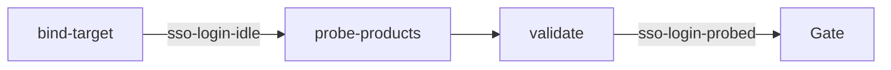

# sso-findong-5040-5041-login

## 目的 / Goal

对生产 SSO `http://sso.findong.com/GetToken` 探测账号能否分别登录产品 **5040**（萧山城管管理平台）与 **5041**（萧山资源化利用网页端）。

说明：`https://sso.findong.com` 对根路径与 `/GetToken` 均 404；`http://sso.findong.com/` 返回「已经成功启动了本项目」，与源码 Index 一致，故本图使用 **HTTP**。

每个产品各发一次错误口令与一次正确口令。证据只记 HTTP、业务 `code`/`msg`、产品码/名、是否有令牌；**不写出口令与令牌原文**。

Goal 槽：`sso-findong-5040-5041-login`

Status: **active**

若替换旧验法：retired ← （无）

## 非目标

- 不写 `JC_Product` / 菜单 / 角色 / 授权
- 不清理 Redis 产品缓存
- 不测 Admin / Recycle Web 页面登录
- 不修改 `repos/` 业务代码
- 不提交 secrets / runs
- Agent 不宣布 P3 通过

## 配置指针

- `./config.yaml`
- `./secrets.local.yaml`（必填；gitignore）
- `./secrets.example.yaml`
- 也可把口令放在仓库根 `.local/`，再由本图 secrets 引用路径（见 `.local/AGENTS.md`）

## Sockets

| | |
|--|--|
| Start | `sso-login-idle` |
| End | `sso-login-probed` |
| Cook | in-place |

## Context

- 指针：`target.baseUrl=http://sso.findong.com`，路径 `/GetToken`
- 指纹：HTTP 响应可 JSON 解析，含业务 `code`
- 产品键：`toProductIds` 中的 ProductCode；显示名只作对照
- 歧义：DNS/证书失败、非 JSON、缺 secrets → 停止

## 状态机 / Cook chain



失败策略：`retries: 0`。只读探测，无写库。

## 行为

1. `bind-target`：读 secrets（`userName` / `passWord`），拼 `POST {baseUrl}/GetToken`。
2. `probe-products`：对 5040、5041 各发错误口令与正确口令；`switchType=0`、`productType` 取自 config（默认 2）、`isPlaintext=true`。
3. `validate`：汇总每产品是否 `code=200` 且 `hasToken=true` 且产品码匹配；写证据包。

## 证据包

相对本次 `runs/<yyyy-MM-ddTHHmmss>/`：

| collector | required | sink |
|-----------|----------|------|
| probes | yes | `prepare/probes.json` |
| summary | yes | `summary.json` |
| report | yes | `report.md` |
| manifest | yes | `manifest.yaml` |

证据不得含口令、令牌字符串、连接串。

## Invoke

experimental

```powershell
powershell -ExecutionPolicy Bypass -File pipelines/graphs/baseplatform/sso-findong-5040-5041-login/scripts/Invoke-SsoFindong50405041Login.ps1
```

## 人闸 / Gate

- `environment: shared`（生产 `http://sso.findong.com`）
- 缺 secrets 时停止
- 最终验收：用户 `pass` / `fail`

## 判定级别

| 级 | 含义 | 谁判 |
|----|------|------|
| P0 | SSO `GetToken` 可达且返回可解析 JSON | Agent 记录 |
| P1 | 错误口令被拒绝（无令牌） | Agent 记录 |
| P2 | 正确口令下 5040 与 5041 均 `code=200` 且有令牌、产品码匹配 | Agent 记录 |
| P3 | 业务上接受本次生产登录探测 | **用户** |

## Handoff

Output socket：`sso-login-probed`。失败常见原因：产品缓存未刷新、缺菜单/角色/授权、`JC_Product.ProductType` 与请求 `productType` 不一致（网页端历史为 2）。
