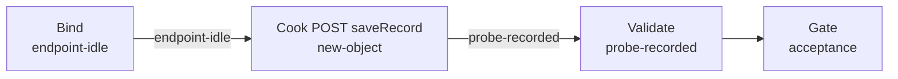

# 330109202203290201-weighbridge（govsync）

## 目的 / Goal

针对接入码 **`330109202203290201`** 的萧山地磅称重上报联调：`POST /sapi/v1/inoutRecord/lantu/saveRecord`。  
场景取自 `_temp/330109202203290201/`（车牌 `浙A12345`，重量 `1.06t` / `1060kg`，抓拍 `test_pic_v2.jpg`，固定时间 `2026-10-26 10:02:08`）。

Goal 槽：`gov-330109202203290201-weighbridge-save`（与 `gdxs20260520002-weighbridge` / `xnxs20240725003-weighbridge` / `xiaoshan-weighbridge` **互不替代**）

Status: **active**

路径：`pipelines/graphs/govsync/330109202203290201-weighbridge/`（见 [`pipelines/AGENTS.md`](../../../AGENTS.md)）

## 非目标

- 不修改 `repos/` 业务代码
- 不提交 secrets / runs
- 不替代 OpenSpec 与 CI
- Agent 不宣布 L3 通过
- **不做** `/sapi/sysdevicemng/heatBeat`
- 不退役姊妹 weighbridge Graph

## 配置指针

- `./config.yaml`
- `./secrets.local.yaml`（gitignore）
- `./secrets.example.yaml`
- 资产源：`_temp/330109202203290201/`
- 夹具：`./fixtures/test_pic_v2.jpg`
- 设计：`docs/2026-08-27-xiaoshan-weighbridge-gate-product-upload-design/01-设计稿.md`

## Sockets

| | |
|--|--|
| Start | `endpoint-idle` |
| End | `probe-recorded` |
| Cook | `new-object` |

## Context

- **指针**：`target.url` = `http://191.12.15.58:8899/sapi/v1/inoutRecord/lantu/saveRecord`
- **指纹**：`buildLicenseNo=330109202203290201`、`goodsWeight=1060`、`carNo=浙A12345`；必填 `dataSource`、`inOutType`；**不得**写入卡口字段 `deviceID` / `siteType` / `areaCode`
- **场景**：对接码 `330109202203290201`；`dataSource=WEIGHBRIDGE_XIAOSHAN`
- **时间**：`snapTimeMode: fixed` → `snapTime=2026-10-26 10:02:08`
- **歧义**：停止并问用户

## 状态机 / Cook chain



1. **bind-endpoint** — 解析 URL、fixtures、`scenario.channel=weighbridge`
2. **cook-post** — 地磅 JSON（含 `dataSource`）；POST
3. **validate-response** — HTTP + `code`/`msg`；L0–L2；不宣布 L3

失败策略：`retries: 2`；`stopOnError: true`。

## 证据包

相对本次 `runs/<yyyy-MM-ddTHHmmss>/`：

| collector | required | sink |
|-----------|----------|------|
| request-response | true | `http/` |
| summary | true | `summary.json` |
| report | true | `report.md` |
| acceptance 副本 | true | `acceptance.md` |

`snapImages` 证据只保留 count / 字节长度。

## Invoke

```powershell
# 相对仓库根（开发机，走 Graph config）
powershell -ExecutionPolicy Bypass -File pipelines/graphs/govsync/330109202203290201-weighbridge/scripts/Invoke-330109Weighbridge.ps1

# 同步夹具 + 组装可拷贝联调包 → _tmp/330109202203290201-weighbridge-package/
powershell -ExecutionPolicy Bypass -File pipelines/graphs/govsync/330109202203290201-weighbridge/scripts/Copy-330109WeighbridgePackage.ps1
```

便携包（内网机双击）：`scripts/internal/Run-330109Weighbridge.cmd` + `.ps1` + `test_pic_v2.jpg`（由 Copy 脚本打到 `_tmp/...-package/`）。

脚本标 **experimental**。非 local 环境与写政府平台须人闸 `YES`。

## Acceptance

见 `./acceptance.md`。Agent **不得**宣布 L3 通过。
