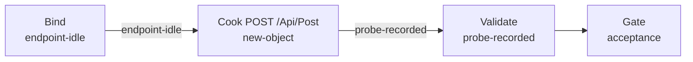

# 330109202306270101-weighbridge（govsync）

## 目的 / Goal

把 `_tmp/1127/` 的抓拍按萧山地磅报文写入城管正式口：`POST http://191.12.234.212:5233/Api/Post`。  
接入码取 `_tmp/1127/330109202306270101` 的 **`330109202306270101`**。

Goal 槽：`gov-330109202306270101-weighbridge-save`（与 `330109202203290201-weighbridge` / `xnxs20251029001-weighbridge` / `xiaoshan-serve-apipost` **互不替代**）

Status: **active**

路径：`pipelines/graphs/govsync/330109202306270101-weighbridge/`（见 [`pipelines/AGENTS.md`](../../../AGENTS.md)）

## 非目标

- 不修改 `repos/` 业务代码
- 不提交 secrets / runs
- 不替代 OpenSpec 与 CI
- Agent 不宣布 P3 通过
- **不**打政府 `lantu/saveRecord`（该路径不在 5233）
- 不退役姊妹 weighbridge Graph
- 不发送 `fdBuildLicenseNo`、`grossWeight`、`deviceID`

## 配置指针

- `./config.yaml`
- `./secrets.local.yaml`（gitignore）
- `./secrets.example.yaml`
- 资产源：`_tmp/1127/`（`330109202306270101` = 场景字段；png = 抓拍）
- 夹具：`./fixtures/72c21216328413eeaebabb0daf22ca8f.png`
- 入站：`LegacyApiController` `POST /Api/Post`；网关 `Match.Path` 同路径
- 映射：`docs/2026-09-03-xiaoshanserve-forward-to-urban-weighing-record/02-字段映射与缺口.md`

## Sockets

| | |
|--|--|
| Start | `endpoint-idle` |
| End | `probe-recorded` |
| Cook | `new-object` |

## Context

- **指针**：`target.url` = `http://191.12.234.212:5233/Api/Post`
- **指纹**：`buildLicenseNo=330109202306270101`、`goodsWeight=1060`、`carNo=浙A12345`、`dataSource=WEIGHBRIDGE_XIAOSHAN`
- **绑定**：Legacy 读取 `siteType`、数字 `inOutType`、`goodsWeight`。配置里的 `placeType` 原样进报文，同时写入同值 `siteType`。`dataSource` 进报文，Legacy **不落库**。
- **重量**：不发送 `grossWeight`，避免 `grossWeight > 0` 覆盖 `goodsWeight`。
- **时间**：`snapTimeMode: fixed` → `snapTime=2026-11-27 10:40:41`
- **响应**：`{ success, msg, code }`
- **歧义**：停止并问用户

## 状态机 / Cook chain



1. **bind-endpoint** — 解析 URL、fixtures、`scenario.channel=weighbridge`
2. **cook-post** — 地磅 JSON（含 `dataSource` / `placeType` / `siteType`）；POST 正式口
3. **validate-response** — HTTP + `code`/`msg`；P0–P2；不宣布 P3

失败策略：`retries: 2`；`stopOnError: true`。当前脚本不内置重试循环，失败即停。

## 证据包

相对本次 `runs/<yyyy-MM-ddTHHmmss>/`：

| collector | required | sink |
|-----------|----------|------|
| request-response | true | `http/` |
| summary | true | `summary.json` |
| report | true | `report.md` |
| acceptance 副本 | true | `acceptance.md` |

`snapImages` 证据只保留 count / 字节长度。

## Invoke

```powershell
powershell -ExecutionPolicy Bypass -File pipelines/graphs/govsync/330109202306270101-weighbridge/scripts/Invoke-330109202306270101Weighbridge.ps1
```

脚本标 **experimental**。`environment: production` 与写入城管称重记录须人闸 `YES`。`/Api/Post` 不要求 Authorization。

## Acceptance

见 `./acceptance.md`。P0–P2 对应历史 L0–L2。Agent **不得**宣布 P3 通过。
