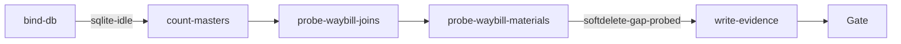

# waybill-softdelete-join-probe（materialclient）

## 目的 / Goal

对现场固废 MaterialClient SQLite 做**只读**探针：确认「材料 / 供应商被删」究竟是 **硬删除（行消失）** 还是 **软删除（`IsDeleted=1` 行仍在）**，并量化对 **订单（Waybill）查询展示** 的信息缺口。

期望对照：若仅为软删除，则「含软删行的 join」应能还原材料名 / 供应商名；「仅 `IsDeleted=0` 的 active-only join」（对齐 ABP `IDeletionAuditedObject` + Repository 默认过滤）会留下空材料/供应商字段。

Goal 槽：`waybill-softdelete-join-gap`

Status: **active**

路径：`pipelines/graphs/materialclient/waybill-softdelete-join-probe/`

## 非目标

- **不修改** `repos/` 业务代码（分析 Graph，不交付修复）
- 不写库、不 ingest、不改现场 `MaterialClient.db`
- 不提交 secrets / runs
- 不替代 OpenSpec / CI；后续若要修查询过滤，另开 change
- Agent 不宣布 L3 通过

## 配置指针

- `./config.yaml`
- `./secrets.local.yaml`（`databaseAbs` → 现场库；gitignore）
- `./secrets.example.yaml`
- Node 工具：`./scripts/probe-softdelete-join.ts`（`node:sqlite`，readOnly）
- 现场指针（用户提供）：`D:\新建文件夹\固废\1112\MaterialClient.db`

## 前置

1. **Node.js 22.5+**；`pipelines/` 下已 `pnpm install`（需 `tsx`）
2. `secrets.local.yaml` 中 `databaseAbs` 指向可读的 `MaterialClient.db`
3. 本 Graph **只读**；无 dryRun 写入开关

## Sockets

| | |
|--|--|
| Start | `sqlite-idle` |
| End | `softdelete-gap-probed` |
| Cook | `new-object` |

## Context

- 指针：本地 SQLite 绝对路径（secrets）
- 指纹表：`Waybills`、`Materials`、`Providers`、`WaybillMaterials`；软删列 `IsDeleted` / `DeletionTime`
- 代码对照（只读引用，不改）：
  - `SolidWasteService` / `StandardService` / `StandardModeService` 的 `BuildMaterialDictAsync` / `BuildProviderDictAsync`（经 `_materialRepository.GetQueryableAsync()`）
  - `WeighingListItemDto.FromWaybill(..., materialsDict, ...)`
  - `Material` / `Provider`：`IDeletionAuditedObject`
- 歧义：路径不可读或缺表 → 停并报告，不猜库

## 状态机 / Cook chain



1. **bind-db** — 解析 DB；只读打开；写 `prepare/bind.json`
2. **count-masters** — Materials / Providers 活跃 vs 软删计数
3. **probe-waybill-joins** — Waybill → Material/Provider：hard-missing vs soft-deleted；active-only 缺口
4. **probe-waybill-materials** — `WaybillMaterials` 行级同类缺口
5. **write-evidence** — `summary.json`、`report.md`、`samples/`

失败策略：`retries: 1`；`stopOnError: false`（能采多少证写多少；缺证写 `source: missing`）。

## 证据包

相对本次 `runs/<yyyy-MM-ddTHHmmss>/`：

| collector | required | sink |
|-----------|----------|------|
| prepare | yes | `prepare/` |
| samples | yes | `samples/` |
| summary | yes | `summary.json` |
| report | yes | `report.md` |

## Invoke

```powershell
powershell -ExecutionPolicy Bypass -File `
  pipelines/graphs/materialclient/waybill-softdelete-join-probe/scripts/Invoke-WaybillSoftdeleteJoinProbe.ps1
```

命令：`/run-pipeline materialclient/waybill-softdelete-join-probe`

## 人闸 / Gate

- 缺 `databaseAbs` / 文件不存在
- 最终验收：用户 `pass` / `fail`（是否解释了订单缺信息）

## 判定级别

| 级 | 谁判 |
|----|------|
| L0 DB 可达 | Agent |
| L1 软删列存在 | Agent 提示 |
| L2 缺口已分类计数 | Agent 提示 |
| L3 与现场现象一致 | **用户** |

## Handoff

Output socket：`softdelete-gap-probed`。若后续要修「订单查询含软删主数据」，另开 OpenSpec；本 Graph 不交付实现。
