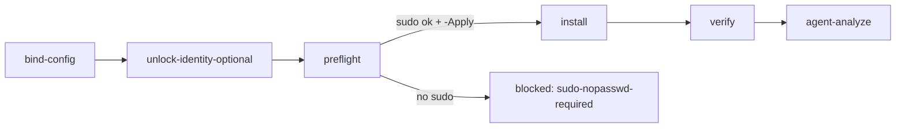

# fev-u2-docker（ops）

## 目的 / Goal

在目标 Hyper-V Ubuntu 虚拟机上安装 Docker Engine，并验证"能运行 Linux 容器 + MSSQL 2022 容器可建库"，采集 **FEV U2** 证据。

蓝图：[`docs/2026-11-02-urbanmanagement-docker-mssql-upgrade/05-部署与切换回滚.md`](../../../../docs/2026-11-02-urbanmanagement-docker-mssql-upgrade/05-部署与切换回滚.md) §1 U2、§1.2 N4/N5。上游：`ops/fev-u1-host`（Verdict `FEASIBLE`，`d1Path=D1-B`）。

Goal 槽：`ops-fev-u2-docker` · Status: **active** · 路径：`pipelines/graphs/ops/fev-u2-docker/`

## 非目标

- 不部署 UrbanManagement，不改 `repos/`
- 不扩容虚拟机（D7 = 暂时缓解：保持 2 vCPU / 3.7 GiB，MSSQL 限内存）
- 不把 Docker Hub 拉取失败当作 U2 失败（MSSQL 来自 `mcr`；Docker Hub 属 U8 / K16）
- 不把 `vanilla` 加入 `docker` 组（等同 root），远端统一用 `sudo docker`

## 前置

1. `fev-u1-host` 已 `FEASIBLE`
2. `secrets.local.yaml`（同 `fev-u1-host`）
3. **人闸 `sudo-nopasswd-required`：** 远端 `vanilla` 免密 sudo。sudo 密码**不能**经本通道传递（`Invoke-SshRemote` 会把整条远程命令写入控制台与 `ssh/meta.json`）
4. 安装类模式须 `-Apply`（人闸 `apply-required-for-install`）

## 状态机 / Cook chain



| 步骤 | 远端动作 | 副作用 |
|------|----------|--------|
| preflight | `sudo -n true`、docker 是否存在、路由、镜像源可达性 | 无 |
| install | 先写 `/etc/docker/daemon.json`（`bip` / `default-address-pools` 避开 `172.17.0.0/16`、`registry-mirrors`、日志轮转、`live-restore`），再从阿里云 `docker-ce` 源装 `docker-ce` + compose 插件，`systemctl enable docker` | 安装软件、改系统配置（幂等） |
| verify | `docker info`、`hello-world`、MSSQL 2022 Express 探针容器（`MSSQL_MEMORY_LIMIT_MB`、`Chinese_PRC_CI_AS`、`TZ`），建库 `fev_u2_probe`，读版本与内存，然后删除探针容器 | 拉取镜像（保留缓存）；探针容器默认删除 |

## Invoke

```powershell
# 只读预检
powershell -ExecutionPolicy Bypass -File pipelines/graphs/ops/fev-u2-docker/scripts/Invoke-FevU2Docker.ps1 -Mode preflight -SkipConfirm
# 安装 + 验证（人闸后）
powershell -ExecutionPolicy Bypass -File pipelines/graphs/ops/fev-u2-docker/scripts/Invoke-FevU2Docker.ps1 -Mode all -Apply -SkipConfirm
```

或：`/run-pipeline ops/fev-u2-docker`

## Agent Verdict 规则（写死在 cook）

| 证据 | Verdict |
|------|---------|
| 远端 sudo 需密码 | `BLOCKED`（gate `sudo-nopasswd-required`，result `blocked`） |
| `DOCKER_OK=yes` 且 `MSSQL_OK=yes` 且无网桥重叠 | `FEASIBLE` |
| Docker 正常但 MSSQL 未就绪 | `INCONCLUSIVE`（附 mssql 日志） |
| Docker 无法运行 / 网桥仍重叠 | `INFEASIBLE` |
| 仅 preflight / install 模式 | `INCONCLUSIVE`（未验证） |

`hello-world` 失败只记入 rationale（Docker Hub 镜像加速问题，K16），不影响 U2。

## 判定级别

| 级 | 内容 | 谁判 |
|----|------|------|
| P0 | SSH 可达、私钥可用 | Agent |
| P1 | 远端脚本执行完成 | Agent |
| P2 | Agent 写出 `FEASIBLE` / `INFEASIBLE` | Agent |
| P3 | 是否采纳本 run | 用户 |

## Handoff

Output socket：`fev-u2-evidenced`。cook 后 Agent **MUST** 把 Run identity + Verdict 回写 `docs/2026-11-02-urbanmanagement-docker-mssql-upgrade/05-部署与切换回滚.md` §1 U2 行与 §1.x 回写节。产品落地仍须 Human `APPROVED` + OpenSpec。
