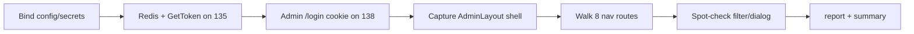

# admin-ui-layout-observe（urban）

## 目的 / Goal

对 **实验室 138** Admin（Blazor + Layui）做布局壳与业务页**只读**观察：侧栏/多标签/顶栏、全量 8 个导航路由非空壳，并对列表筛选/分页与一个只读详情或照片对话框做点检；产出截图、DOM 快照与评审报告。

**登录：** `loginMethod=redis-session` — 对 **135 SSO** `POST /GetToken`（默认账号见 `config.yaml` / secrets，产品 **5040**），由 SSO **写入 Redis** `FdSoftSSO:{userId}:{clientId}`。Admin 的 `UrbanAdmin.Session` 为 **HttpOnly Cookie**，无法只靠改 Redis 或浏览器 CDP 注入；须 Admin 服务端 SignIn（可用 Agent 自动过验证码，避免人工在页面输入）。不走 SSO 门户页。

Goal 槽：`admin-ui-layout-interaction-review`

Status: **active**

路径：`pipelines/graphs/urban/admin-ui-layout-observe/`（见 [`pipelines/AGENTS.md`](../../../AGENTS.md)）

若替换旧验法：retired ← （无）

## 非目标

- 不修改 `repos/` 业务代码
- 不提交 secrets / runs
- 不替代 OpenSpec 与 CI
- Agent 不宣布 P3 / 产品通过
- **不**点审批通过/驳回、启用同步、退出登录写操作
- **不**打正式口 191；**不**评 Recycle `5334`
- **不**手写伪造 `UrbanAdmin.Session`（须经 Admin `/login` 签发）

## 配置指针

- `./config.yaml` — `baseUrl` 138、`ssoBaseUrl` 135、`userName`、`loginMethod`
- `./secrets.local.yaml`（gitignore）— `passWord`；可选 `redisConnection` 覆盖
- `./secrets.example.yaml`
- `./expect/surface.md`
- Redis 默认：`.local/SSO/appsettings.json` → `RedisServer:Default`
- 布局源码：`repos/UrbanManagement/src/UrbanManagement.Admin/Pages/AdminLayout.razor`

## Sockets

| | |
|--|--|
| Start | `admin-session-pending` |
| End | `admin-ui-observe-captured` |
| Cook | `new-object`（每次 `runs/<ts>/`） |

## Context

- **指针**
  - Admin：`http://192.168.3.138:5333`
  - SSO：`http://192.168.3.135:8500/GetToken`
  - 账号：`13777554358`（口令仅 secrets）
  - 路由：`config.yaml` `target.routes`（与 `AdminLayout` `_navItems` 一致）
  - 浏览器：cursor-ide-browser（Cookie 建立后 walk）
- **指纹**：侧栏 8 项；`layui-layout-admin`；各页卡片/表或空态
- **前置**：138 栈、135 SSO、135 Redis、secrets 口令
- **歧义**：停并问用户

## 状态机 / Cook chain



编号步骤（与 `config.yaml` 1:1）：

1. **bind-config** — 读 config/secrets；创建 `runs/<ts>/`。
2. **redis-login** — ping Redis；可选 `HDEL AllTable JCProduct`；`POST` 135 `GetToken`（写 Redis 会话，证据脱敏）；再 `POST` 138 `/login` 拿 Cookie。验证码挡路 → 人闸 `captcha-or-login-blocked`。
3. **capture-shell** — 侧栏 8 项、顶栏、标签；`shell.png`。
4. **walk-routes** — 八路由截图 + snapshot；对照 `expect/surface.md`。
5. **spot-interact** — 筛选/分页点检；可选只读对话框。
6. **write-report** — `summary.json`、`report.md`；P0–P2 采证（P3 仅用户）。

失败策略：`retries: 2`；`stopOnError: false`。

## 证据包

| collector | required | sink |
|-----------|----------|------|
| redisLogin | true | `prepare/redis-login.json`（无口令/无 Token 明文） |
| screenshot | true | `screenshots/` |
| snapshot | true | `snapshots/` |
| summary | true | `summary.json` |
| report | true | `report.md` |

## Invoke

```powershell
powershell -ExecutionPolicy Bypass -File `
  pipelines/graphs/urban/admin-ui-layout-observe/scripts/Invoke-AdminUiLayoutObserve.ps1 -SkipConfirm
```

脚本（experimental）：建 run、HTTP 预检、**Redis + GetToken + Admin login** 预登；浏览器 walk 仍由 Agent MCP 完成。

亦可用：`/run-pipeline urban/admin-ui-layout-observe`

## 人闸 / Gate

- `missing-secrets` / `captcha-or-login-blocked`
- `shared-environment`（138 实验室）
- `acceptance`（P3 仅用户）

## 判定级别（Pipeline）

| 级 | 谁判 | 含义 |
|----|------|------|
| P0 | Agent | Redis/GetToken/Admin Cookie 可达 |
| P1 | Agent | 布局壳 + 8 路由采证 |
| P2 | Agent 提示 | expect + 点检 |
| P3 | **用户** | 产品观感 |

Pipeline pass ≠ 产品 `APPROVED`。

## Handoff

Output socket：`admin-ui-observe-captured`。产品改动须另开 OpenSpec。
