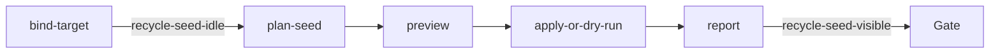

# recycle-web-contract-vehicle-seed

## 目的 / Goal

向 138 上 Recycle Web 当前绑定的 5020 项目写入合同管理和车辆管理测试数据。页面 `/api/contracts` 与 `/api/vehicles` 读取的就是这四张表。

Goal 槽：`recycle-web-contract-vehicle-seed`

Status: **active**

若替换旧验法：retired ← （无）

## 非目标

- 不修改 `repos/` 业务代码
- 不新建公司、材料、附件或运输台账
- 不调用市平台，不把 `SyncStatus` 写成已成功
- 不提交 secrets / runs
- Agent 不宣布 P3 通过

## 配置指针

- `./config.yaml`
- `./secrets.example.yaml`
- `./contract.yaml`
- SSH 密钥沿用 `pipelines/graphs/ops/deploy-urban-lab-138/secrets.local.yaml`，不在本图另存一份口令

## Sockets

| | |
|--|--|
| Start | `recycle-seed-idle` |
| End | `recycle-seed-visible` |
| Cook | in-place |

## Context

- 指针：`target.sourceProId`，并且必须等于主机 compose 里 `um-recycle` 的 `RecyclePersistence__BoundSourceProId`
- 指纹：`dbo.GovProjects` 上该 `SourceProId`、`ProductCode=5020`、未删除的行恰好 1 条
- 合同键：`ProId` + `ContractNo`。编号是车次 `dataNo`：`fl-xnyh20251113001-20260101060821-0001`、`fl-xnyh20251113001-20260101061000-0002`
- 车辆键：`ProId` + `PlateNumber`（`浙A35586D`、`浙A33606D`）
- 来源：`sand-addbatch-submit` 的 `seeds/2026-01/source-run/2026-09-09T152356/json/2026-01-tengman.part000.json` 前两条。购买方、收货地址、产品名、净重、皮重只取该车次。池子没有生产方、运输方、电话和单价，这些列留空，单价按 0 写入
- 歧义：同一键已有别的未删除行，或绑定项目不是这一条 5020 时停止

## 状态机 / Cook chain



失败策略：`retries: 0`。默认只预览。`-Apply` 才提交。

## 行为

1. `bind-target`：读取部署图的 SSH 配置。远程核对 compose 绑定等于 `sourceProId`。
2. `plan-seed`：校验 `fixtures/seed.json` 的长度、金额和主键，写出预览 SQL 与写入 SQL。
3. `preview`：统计 5020 行、已有种子行和冲突行。
4. `apply-or-dry-run`：无 `-Apply` 时到此结束。`-Apply` 在事务里更新或插入这两份合同和两辆车，并只替换这两份合同自己的明细和运输方。已有同号合同或同车牌但不是种子主键时回滚。
5. `report`：把计数写入 `summary.json` 与 `report.md`。验收保持 pending。

合同页面上的上报状态来自枚举名。种子的 `SyncStatus=0`，页面显示 `None`。车次净重、皮重的单位是吨，入库列是千克：22.48 吨为 22480 千克，13.50 吨为 13500 千克。页面再按吨显示。

## 证据包

相对本次 `runs/<yyyy-MM-ddTHHmmss>/`：

| collector | required | sink |
|-----------|----------|------|
| plan | yes | `prepare/plan.json` |
| preview sql | yes | `prepare/seed.preview.sql` |
| apply sql | yes | `prepare/seed.apply.sql` |
| summary | yes | `summary.json` |
| report | yes | `report.md` |
| manifest | yes | `manifest.yaml` |

证据不写 SSH 口令、数据库口令或连接串。

## Invoke

- 命令：`/run-ingest-pipeline urban/recycle-web-contract-vehicle-seed`
- 脚本（experimental）：

```powershell
powershell -ExecutionPolicy Bypass -File pipelines/graphs/urban/recycle-web-contract-vehicle-seed/scripts/Invoke-RecycleWebContractVehicleSeed.ps1
powershell -ExecutionPolicy Bypass -File pipelines/graphs/urban/recycle-web-contract-vehicle-seed/scripts/Invoke-RecycleWebContractVehicleSeed.ps1 -Apply
```

## 人闸 / Gate

- 缺部署图密钥
- 目标是 138 实验室库，不是本机库
- 写入必须带 `-Apply`
- 最终验收：用户 `pass` / `fail`

## 判定级别

| 级 | 谁判 |
|----|------|
| P0 实验室库可查询 | Agent |
| P1 计划已生成 | Agent |
| P2 `-Apply` 后行数与计划一致 | Agent 提示 |
| P3 页面上的测试数据可接受 | **用户** |
